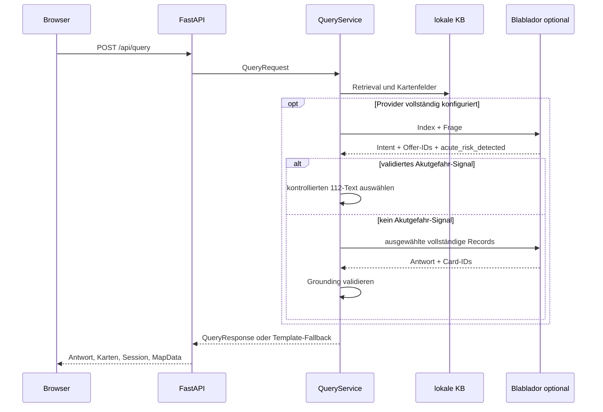

# Datenflüsse und Schnittstellen

## Nutzeranfrage

`QueryRequest` enthält `query`, `language`, optional `category` und
`session_id`. `QueryResponse` enthält Antwort, Karten, Providerstatus,
Sitzungsverlauf und optionale Kartendaten. Pydantic begrenzt die Frage auf 1000
Zeichen und normalisiert Whitespace.

`acute_risk_detected` ist ein verpflichtendes striktes boolesches Feld der
ersten strukturierten LLM-Antwort. Bei `true` bricht `QueryService` vor
Formulator, Retrieval, Karten und normaler Antwort ab. Die Anwendung wählt einen
festen Text für `de`, `en`, `pl`, `ro` oder `ru`; das LLM kann weder diesen Text
noch die Nummer 112 verändern. Fehlende, ungültige oder nicht parsebare Felder
lösen das bestehende technische Fallback aus und gelten nicht als erkannte oder
ausgeschlossene Gefahr. Das Verfahren besitzt keine Risikostufen und keine
zusätzliche Keyword-Klassifikation.

## WFS-Aktualisierung

`sync_wfs()` ruft WFS 2.0 `GetFeature` als GeoJSON ab. Die Pipeline validiert
Typ, erforderliche Properties, eindeutige `lnr`-IDs und Point-Geometrien. Danach
entstehen normalisierte `OfferRecord`s und stabile Feature-/Dataset-Hashes.
`--check` schreibt ausstehende Daten unter `runtime/wfs/`; `--promote` ersetzt
den kanonischen Stand atomar und aktualisiert Snapshot und Änderungsbericht.

## Übersetzungen

Karten werden aus deutschen Quelldaten erzeugt. `offer_translation_hash()`
erkennt fachlich veränderte Angebote. Der Wartungsbefehl schreibt maschinelle
Übersetzungen nach `data/i18n/offer_translations.json`; manuelle Overrides werden
zuletzt angewendet. Nutzeranfragen lösen keine Übersetzung kompletter Angebote
aus.

## Speech

`POST /api/speech/transcribe?language=de` erwartet rohe Audiobytes; der
Content-Type bestimmt die temporäre Dateiendung. Der Server sendet Audio an
einen konfigurierten OpenAI-kompatiblen Transkriptionsendpunkt.

`POST /api/speech/synthesize` erwartet JSON mit `text` und `language`. Je nach
Konfiguration wird ein OpenAI-kompatibler Endpunkt oder `edge-tts` genutzt. Bei
Providerfehlern antworten beide Endpunkte mit HTTP 503 und geben keine internen
Zugangsdaten aus. Unmittelbar vor beiden Syntheseprovidern ersetzt
`normalize_tts_text()` das Token `112` durch sprachabhängig einzeln gesprochene
Ziffern; im Browser und in `QueryResponse` bleibt `112` sichtbar.

## Persistenz und Datenschutz

Sessions werden als JSON gespeichert, enthalten Fragen und Antworten und laufen
konfigurierbar ab. Die Speicherung ist dateibasiert und nicht gegen parallele
Schreibzugriffe mehrerer Prozesse abgesichert. `runtime/` sollte daher lokal,
zugriffsgeschützt und gemäß dem Datenschutzkonzept regelmäßig bereinigt werden.
