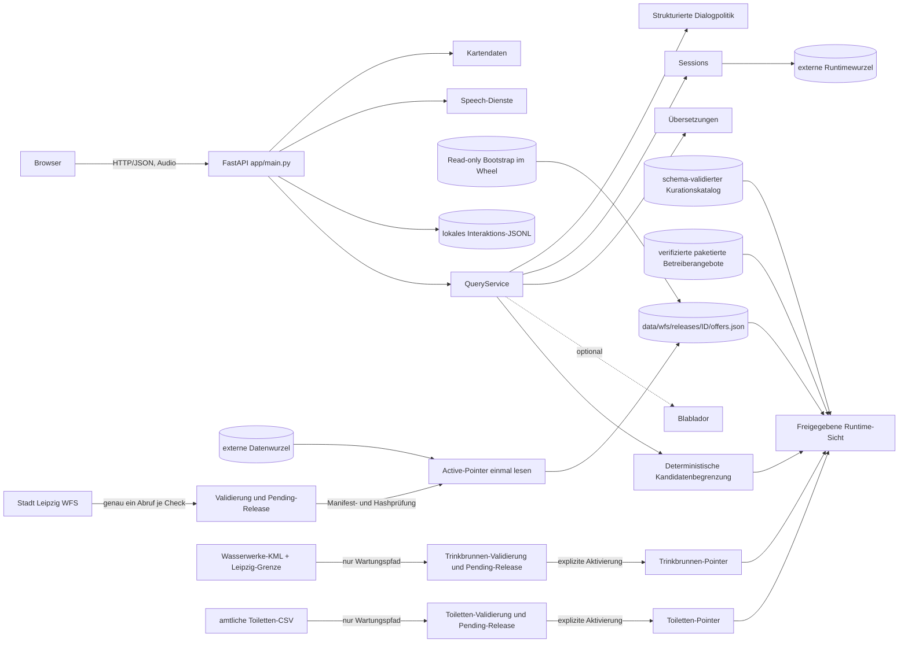

# Architektur

## Systemgrenze

LENA besteht aktuell aus einer einzelnen FastAPI-Anwendung mit statischem
Frontend und dateibasierter Persistenz. Es gibt keine separate Datenbank und
keinen separaten Frontend-Build. Die Anwendung beantwortet Nutzerfragen niemals
durch einen Live-Aufruf des WFS.

## Komponenten

`app/main.py` erzeugt die App, lädt die Wissensbasis, initialisiert Query- und
Speech-Dienste, startet optional die WFS-Hintergrundprüfung und registriert alle
Routen. Ein erfolgreicher automatischer Promote lädt die Wissensbasis neu.

Öffentliche Toiletten und feste Trinkwasserbrunnen bilden daneben je einen
eigenen Release- und Datentyp. Sie werden nicht zu sozialen Angeboten
konvertiert und durchlaufen keine sozialen Zielgruppenregeln. Brunnen außerhalb
Leipzigs und mobile Brunnen ohne verifizierten Zeitraum bleiben ausschließlich
in Quellrelease und Provenienz. `app/spatial.py` ist die einzige Definition von
Haversine-Luftlinie und EPSG:25833-Transformation; `LEIPZIG_HBF` bleibt darin
Standard- und Testwert des Referenzpunkts. `QueryService` löst den tatsächlich
verwendeten Ursprung einmal pro Prozess aus `Settings.hbf_latitude`/
`hbf_longitude` (`HBF_LATITUDE`/`HBF_LONGITUDE`, siehe
[Konfiguration](configuration.md#räumliche-auswahl)) auf und reicht ihn an
Kandidatenordnung, Toiletten und Trinkbrunnen weiter. Der
gemeinsame Runtime-Fingerprint bindet sozialen Release/Kuration sowie Toiletten-
und Trinkbrunnen-Release, Hash und Normalisierung; bei einer Änderung verwirft
die zentrale Sessionlogik den fachlichen Altverlauf.

`app/service.py` ist die fachliche Orchestrierung. Der Dienst löst Sessions auf,
führt zuerst den engen Preflight und danach den LLM-Interpreter aus und wertet
den validierten Risikostatus vor Scope, Selbstbeschreibung, Fachdialog,
Kandidaten und Infrastruktur aus. `app/safety.py` begrenzt diese Entscheidung
deterministisch; Nummer und sichtbare Texte stammen aus versionierten lokalen
Policy- und I18n-Ressourcen.

Bei `drinking_water` verbindet `app/infrastructure_results.py` die positive
soziale `CandidateDecision` mit der freigegebenen Brunnenprojektion. Fachliche
Pflichtresultate bleiben vorn; danach folgen ausschließlich HBF-Luftlinie und
stabile ID. Eine ausdrückliche Trinkbrunnenanfrage verwendet im belegten
Saisonfenster nur feste Brunnen. Der LLM-Selector wird mit dem redigierten Grund
`deterministic_spatial_ranking` umgangen. Höchstens drei Resultate erreichen
Evidence und Karten, alle zulässigen Geometrien erreichen die Karte. Ein
erkanntes Stadtteilfeld bleibt für dieses Ranking wirkungslos.

Zeitgebundene soziale Wasserleistungen müssen vor dieser räumlichen Projektion
positiv zum angefragten Zeitbezug oder, ohne Zeitangabe, zur aktuellen
Europe/Berlin-Zeit passen. So kann der mobile Hilfebus nur während seiner
belegten Sonntagsstandzeit als Wasserort am Hauptbahnhof erscheinen. In
allgemeinen Hilfefällen bleibt er dagegen ein telefonischer `referral_contact`
mit den belegten mobilen Einsatzzeiten; seine Organisationsadresse wird nicht
als Nutzerstandort oder Marker projiziert.

Dasselbe Prinzip gilt für mobile Touren ohne verifizierte Einzelkoordinaten:
TiMMi ToHelp bleibt ein ServiceOffer mit einer kuratierten Donnerstagsroute.
Standzeiten und Erkennungshinweis gelangen aus der gemeinsamen Runtime-KB in
Evidence, Karte und TTS; die alte WFS-Punktgeometrie wird weder als aktueller
Tourstopp noch für eine Entfernungswertung verwendet.

`app/curation.py` validiert Organisationen, Standorte, getrennte
Leistungsangebote, Organisations- und Angebotsaliase, Quellenreferenzen und
Kurationsentscheidungen. Der Katalog ist an Release-ID und Hash eines
unveränderlichen normalisierten WFS-Stands gebunden. Erst seine Projektion wird
von Aliasauflösung, Kandidatenbegrenzung, Formulator, Karten und Map-Markern gemeinsam verwendet.
Ein abweichender aktiver WFS-Stand wird in Health als ausstehende Quelländerung
gemeldet und nicht ungeprüft in die Runtime-Sicht übernommen.

Zwei Jugendnotangebote des VKKJ stammen nicht aus dem WFS. Sie liegen deshalb
als eigene, schema-validierte Betreiberquelle in
`app/resources/bootstrap/official/verified_offers.json`. Der Loader prüft
Quellenreferenzen, Positivschema und Dateihash, verbindet die Records erst
danach mit dem exakt gebundenen WFS-Stand und erzeugt weiterhin genau eine
kuratierte Runtime-Projektion. Der Kurationskatalog bindet auch diesen Hash;
der gemeinsame Session-Fingerprint ändert sich bei einer Änderung der
Betreiberquelle. Ein fehlender, ungültiger oder abweichender Betreiberstand
führt zu einem kontrollierten Fehler, niemals zu einer Teilprojektion.

`app/candidate_contract.py` definiert den strikten, versionierten Vertrag der
Kandidatenstufe. `app/candidates.py` wendet ausschließlich positiv kuratierte
Leistungen, Ortstypen, Zielgruppen-, Zugangs-, Verweis-, Zeit- und
Prioritätsmerkmale an. Das Ergebnis trennt `direct_service`, `referral_contact`
und `conditional_candidate`, enthält maschinenlesbare Ein- und Ausschlussgründe
und dokumentiert Konflikte mit dem schwächeren UI-Hinweis. Bedingte Kandidaten
werden weder an Formulator noch Karten weitergegeben. `app/retrieval.py` enthält
noch lexikalische Hilfsfunktionen und isolierte Legacy-Tests, ist aber nicht mehr
der primäre Kandidatenpfad. Die früheren namens- beziehungsweise
`source_index`-gebundenen Auswahlmodule `app/offer_roles.py` und
`app/temporal.py` sind entfernt.

`app/interpreter.py` definiert den versionierten ersten Modellvertrag. Der
Interpreter sieht keinen Angebotsindex und keine Angebots- oder Quellen-IDs. Er
liefert ausschließlich Bedarf, Scope, Eingabesprache, ausdrücklich genannte
Fakten, getrennte unsichere Hinweise, potenziell relevante Informationslücken
und das dreiwertige Signal `acute_risk_status`. Modellantworten müssen reines
JSON sein und werden mit verbotenen Zusatzfeldern, strikten Typen, begrenzten
Texten und semantischen Querverträgen validiert. Alias-Hinweise bestehen nur aus
Aliastext, Aliasart und Mehrdeutigkeit.

`app/dialogue.py` ersetzt den früheren booleschen Klärungsmarker durch genau
einen schema-validierten Dialogzustand pro Session. Er enthält nur Dialogart,
angefragte Felder, begrenzte ausdrückliche Fakten, stabile Choice-Werte,
Versuchszahl, Ablaufzeit und Runtime-Fingerprint. `app/dialogue_flow.py` bildet
Buttons deterministisch auf Bedarf oder ausdrückliche Fakten ab; Freitext und
STT-Transkripte laufen mit einem minimalen offenen Dialogkontext erneut durch
den Interpreter. Beide Wege verwenden danach denselben `CandidateSelector`.
Die explizite Altersgruppe trennt `under_18` von den Erwachsenenbereichen
18–26 und ab 27, ohne ein numerisches Alter zu erfinden.

Die aktive Politik kennt Schlafzielgruppe, eine einmalige Schlaf-Altersfrage,
A1/Schoppi-Leistungsart, Mobile/Kübel-Ort, allgemeinen Bedarf und den
vorrangigen Safety-Dialog `acute_risk_confirmation`. Allgemeine
Dialoge haben einen Versuch; nur die Schlaf-Altersabsicherung darf unmittelbar
als zweiter Schritt folgen. Der allgemeine Bedarfsdialog öffnet sich sowohl bei
`need=general_help` als auch bei `need=unknown` (AP10: unklare, aber
möglicherweise relevante Anfrage) — beide werden auf denselben
Originating-Need normalisiert. Bleibt die Lage unklar, stammen Telefon und
Zeiten des Hilfebus ausschließlich aus dem kuratierten Runtime-Datensatz.
Akutrisiko oder Out-of-Scope schließen den Dialog vorher ohne Hilfebus oder
Angebote.

Für Schlafbedarf gilt keine U27-Priorität mehr. Bei 14 bis 17 Jahren ist die
Kontakt- und Notschlafstelle für Jugendliche der direkte erste Dienst und der
Jugendnotdienst ein ergänzender Schutz- und Vermittlungskontakt. Bei 12 bis 13
Jahren wird nur der Jugendnotdienst als belegter erster Kontakt verwendet; bei
`under_18` ohne Zahl bleibt die Notschlafstelle bis zur Altersklärung bedingt.
Ein ausdrücklicher Schutz- oder Krisenbedarf priorisiert den Jugendnotdienst.
Ab 18 führt der Schlafpfad nach den kuratierten Erwachsenenregeln zu Rücke
beziehungsweise bei ausdrücklich bekannter weiblicher Zielperson zu Scharni.
Jugendtreffs und Jugendstreetwork bis einschließlich 26 werden unabhängig
davon nur durch ausdrücklichen Jugendbedarf oder einen exakten Alias aktiviert;
ein Alter allein genügt nicht.

Bei `acute_risk_status=detected` beendet `QueryService` den normalen Pfad
unmittelbar und gibt den zentralen sprachabhängigen 112-Text ohne Karten aus.
Bei `uncertain` öffnet es den fingerprintgebundenen Safety-Dialog. Ja und
Unsicher führen deterministisch zu 112; nur ein validierter Modellstatus plus
eine kontrolliert ausdrückliche Verneinung öffnet den strukturierten
ursprünglichen Bedarf wieder. Das LLM erzeugt weder Nummer, Text noch
Eskalationsziel und kann den Abbruch nicht allein aufheben.

Nach der Interpretation erzeugt genau eine deterministische Kandidatenkomponente
die zulässige Menge. Ihr Vertrag Version 2 trennt verbindliche,
auswählbare, bedingte und ausgeschlossene Kandidaten. Fachliche Eignung,
Zugang, dokumentierte Zeitbedingungen und kuratierte Prioritäten werden vor
jedem weiteren Modellaufruf geprüft. Mandatory-Kandidaten wie kuratierte erste
Verweise verlassen diese Stufe bereits in bindender Reihenfolge.

`app/llm_selection.py` baut ausschließlich aus `selectable_candidates` einen
kompakten Positivlistenindex. Er enthält weder Kontakte, Adressen, Rohdaten,
Reviewnotizen noch bedingte oder ausgeschlossene Angebote. Ab zwei tatsächlich
auswählbaren Kandidaten darf `BlabladorProvider.select_candidates()` eine
Teilmenge nennen. Die gesamte JSON-Antwort wird gegen exakt diesen aktuellen
Index validiert; fremde, doppelte oder zu viele IDs verwerfen die vollständige
Modellantwort. Mandatory-Kandidaten werden anschließend deterministisch
vorangestellt und die Modellmenge in der stabilen Candidate-Reihenfolge
ausgegeben. Bei einem oder ausschließlich mandatory Kandidaten entfällt der
zusätzliche Aufruf mit maschinenlesbarem Bypassgrund.

Der alte Adapter `Interpreterbedarf → Category → Retrieval`, der frühere
ID-selektierende LLM-Router, der ungenutzte Kandidatenindex und die direkte
erste-vier-Übergabe sind nicht mehr aktiv. `app/formulation.py` projiziert die
höchstens vier finalen Runtime-Angebote in den Evidence-Vertrag 2. Er enthält
nur freigegebene Positivlistenfelder, Kandidatenrollen, opake Faktenreferenzen
und bindende Policies. Conditional-, Excluded- und Sozialamt-Angebote sowie
WFS-Rohfelder, Reviewnotizen und technische Provenienz gelangen nicht hinein.

Der Formulatorvertrag 2 besteht aus ein bis drei kurzen Sätzen. Jeder Satz
nennt Claimtyp, Angebots- und Faktenreferenzen oder einen erlaubten
Policybaustein; freier Text außerhalb des JSON-Vertrags existiert nicht.
`app/grounding.py` validiert die Antwort atomar gegen genau das Evidence-Paket:
Rollen, Fakt-Angebot-Zuordnung, operative Zahlen, Adressen, Kontakte, URLs,
Zeiten, Zielskript, Längen, interne IDs und Kartenbindung. Mandatory-Karten und
die deterministische Reihenfolge werden serverseitig wiederhergestellt.
Kapazitäts-, Echtzeit- und garantierte Aufnahmebehauptungen werden verworfen.
Diese Prüfung ist keine vollständige semantische oder linguistische
Qualitätsbewertung; dafür bleibt eine manuelle Evaluation erforderlich.

Scheitert der Selector technisch, verwendet die Anfrage nur die stabile
deterministische CandidateDecision und den Templatepfad; der gleiche Provider
wird nicht unmittelbar nochmals als Formulator aufgerufen. Jeder
Formulatorfehler verwirft die vollständige Modellantwort und verwendet nur die
bereits finalen Angebote im lokalisierten, rollenrichtigen Templatefallback.

Interpreter, Selector und Formulator verwenden denselben asynchronen
HTTPX-Transport, aber getrennte Stufengrenzen von standardmäßig 15, 10 und 30
Sekunden. Eine requestlokale monotone Budgetinstanz begrenzt ihre kumulierte
tatsächliche Providerwartezeit zusätzlich auf standardmäßig 45 Sekunden. Jede
Stufe erhält `min(Stufengrenze, Restbudget)`; bei erschöpftem Budget startet
keine weitere Modellstufe. Deterministische Verarbeitung wird nicht als externe
LLM-Wartezeit gezählt. HTTPX begrenzt zusätzlich seine Transportphasen.
Transportfehler werden nicht automatisch wiederholt. Scheitert bereits der
Interpreter durch Timeout, HTTP-/JSON-/Schema-/Vertragsfehler, Budget oder
Nichtverfügbarkeit, endet die Anfrage fail-closed mit einem technischen Text
und bedingtem 112-Hinweis. Kandidaten, Infrastruktur, Selector und Formulator
laufen nicht; eine lexikalische Fachklassifikation wird nicht verwendet.

`app/resources.py` löst statische Paketressourcen und den rein lesbaren
Bootstrap unabhängig vom aktuellen Arbeitsverzeichnis auf. Im Source-Checkout
bleiben `data/` und `runtime/` kompatible Standards. Eine Wheel-Installation
verwendet externe, konfigurierbare Daten- und Runtimewurzeln und schreibt nie in
`site-packages`. Der Bootstrap ist der einzige paketierte Startstand; ein
externer valider Active-Pointer hat Vorrang, Pending-Releases niemals.

`app/version.py` liest die kanonische Version aus den Paketmetadaten. Wheel,
FastAPI, CLI und Interaktionsprotokoll verwenden diesen Wert; nur ein nicht
installierter Source-Baum ohne Metadaten erhält die eindeutige Kennzeichnung
`0+unknown`. Interaktions- und WFS-Schema-Versionen bleiben getrennte Verträge.

`app/wfs_sync.py` validiert eine vollständige GeoJSON-FeatureCollection,
normalisiert Features und berechnet stabile Hashes. `app/wfs_releases.py`
schreibt daraus einen unveränderlichen Ordner mit `offers.json`,
`snapshot.geojson`, `diff.json` und typisiertem `manifest.json`. Promotion lädt
nicht erneut vom WFS, sondern prüft alle gespeicherten Bytes und ersetzt zuletzt
genau den kleinen Pointer `data/wfs/active_release.json` atomar. Rollback nutzt
denselben validierten Pointerwechsel. `app/kb_loader.py` liest den Pointer pro
Ladevorgang einmal und verwendet danach nur diesen Release; solange noch kein
Pointer existiert, diagnostiziert `app/kb_loader.py` diesen Zustand getrennt
vom Runtime-Bestand. Die Nutzeranwendung lädt ausschließlich die kuratierte
Projektion: zuerst den exakt kataloggebundenen und vollständig verifizierten
lokalen Release, danach den manifest- und hashverifizierten Paket-Bootstrap.
Ungefilterte normalisierte Daten sind nur über die ausdrückliche
Wartungsfunktion `load_normalized_source_release()` erreichbar.

`app/i18n.py` führt deutsche Quelldaten, gespeicherte Übersetzungen und manuelle
Overrides zu Karten zusammen. Es liest einen vorhandenen externen Store oder
sonst den paketierten Bootstrap. `app/translate_offers.py` schreibt ausschließlich
in die externe Datenwurzel und aktualisiert den Store explizit als
Wartungsschritt, nicht während einer Nutzeranfrage.

`app/sessions.py` speichert eine begrenzte Anzahl kurzer Frage-/Antwortpaare in
`runtime/sessions.json`. Ein nach absolutem Pfad geteilter `RLock` umfasst im
Einzelprozess den gesamten Lese-Bereinigungs-Änderungs-Schreib-Zyklus. Writes
werden als eindeutige temporäre Datei im Zielordner geschrieben, mit `fsync`
gesichert und per `os.replace()` atomar aktiviert. TTL- und Kapazitätsbereinigung
laufen opportunistisch bei Sessionzugriffen. Beschädigtes JSON wird unter
`runtime/` als `sessions.corrupt.<Zeit>.<UUID>.json` quarantänisiert; ein
Persistenzfehler verhindert die fachliche Antwort nicht. Vor Verwendung eines
Verlaufs vergleicht der Store dessen Runtime-Fingerabdruck aus Quellenrelease,
Quellenhash und Kurationsstand. Legacy- und abweichende Sessions werden fachlich
zurückgesetzt und erhalten eine neue Session-ID. Ein reiner Sprachwechsel
aktualisiert dagegen die Antwortsprache und erhält einen gültigen Dialog.
Dialogantworten werden unter demselben Lock einmalig beansprucht; parallele,
abgelaufene, fremde oder manipulierte Antworten werden redigiert abgewiesen.
Diese Mechanismen
koordinieren keine mehreren Prozesse oder Uvicorn-Worker. `app/maps.py`
transformiert WFS-Koordinaten aus
EPSG:25833 nach WGS84 und erstellt Ziele relativ zum Leipziger Hauptbahnhof.
`app/speech.py` kapselt externe Speech-Endpunkte und `edge-tts`.
Vor der Synthese ersetzt der Adapter das eigenständige Token `112`
sprachabhängig durch einzeln gesprochene Ziffern. Die visuelle API-Antwort bleibt
unverändert. Der TTS-Endpunkt verlangt zusätzlich die aktive Session-ID und
akzeptiert nur den exakten letzten sichtbaren Antworttext dieser Session und
Sprache. Faktenreferenzen, Policy-IDs, Fehlercodes oder clientseitig veränderte
Texte können dadurch nicht als reguläre Antwort synthetisiert werden.

STT und TTS besitzen jeweils eine konfigurierbare Gesamtgrenze von standardmäßig
45 Sekunden. OpenAI-kompatible Aufrufe erhalten zusätzlich denselben HTTPX-
Transporttimeout. Bei Edge-TTS bricht Cancellation den lokalen asynchronen
Stream ab; LENA kann nicht garantieren, dass dadurch bereits begonnene Arbeit
des externen Dienstes beendet wird. Die Adapter erzeugen keine temporären
Audiodateien, sondern halten Request und Ergebnis im Speicher.

`app/interactions.py` trennt das lokale Forschungsprotokoll vom technischen
Logging. Der HTTP-Adapter schreibt nach dem finalen `QueryService`-Ergebnis
genau eine validierte UTF-8-JSONL-Zeile nach
`runtime/logs/interactions.jsonl`. Sie enthält die tatsächlich verarbeitete
Anfrage, die tatsächlich sichtbare Antwort, kurzlebige Session-ID, Sprache,
Eingabemodus, Antwortpfad, Quellen-IDs, Kandidatenzahl und redigierten
Kandidatenstatus sowie Safety- und
Fallbackstatus und – bei pointerbasierten WFS-Daten – die tatsächlich für die
Antwort geladene `data_release_id`. Das Interaktionsschema besitzt deshalb
Version 11. Safety-Eingaben werden vor Session- und JSONL-Persistenz redigiert;
gespeichert werden nur Status, Pfad, Dialogergebnis, Fallback und Sprache. Ein-
und Ausschlusslisten, Gefahrenfreitext, Diagnose, Score, Fakten, Reason Codes und freie
Modellüberlegungen werden nicht zusätzlich persistiert. Eine kleine Sperre schützt parallele Threads desselben
Prozesses; Schreibfehler werden redigiert geloggt und verändern die Antwort
nicht. Mehrprozesssynchronisierung, Rotation und ein Forschungsdaten-Backend
sind nicht implementiert.

Das technische Logging verwendet stabile Ereignisnamen für HTTP-Laufzeiten,
Interpreter, Kandidatenbegrenzung, Formulator, Fallback, Akutgefahr, Speech, Sessions, WFS und
Interaktions-Schreibfehler. Diese Logs enthalten absichtlich keine vollständigen
Anfragen oder Antworten. Das vollständige Interaktionsprotokoll ist davon
konfigurations- und dateiseitig getrennt.

Das Frontend baut Leaflet-Popups in `app/static/app.js` als DOM-Knoten auf.
Dynamische Labels und Adressen gelangen ausschließlich über `textContent` und
`createTextNode()` in diese Knoten. Die vendorte Leaflet-Version übernimmt
Nicht-String-Inhalte direkt per `appendChild`; WFS-, Wissensbasis- und
Übersetzungswerte werden daher im Popup nicht als HTML interpretiert. Für
spätere Popup-Erweiterungen gilt dieselbe Grenze: Text über DOM-Text-APIs,
Links nur nach expliziter Protokollprüfung.

## Tatsächliche Betriebsprofile

- Ohne Interpreterzugang: Start und Health funktionieren, freie Anfragen fallen
  jedoch geschlossen auf den technischen 112-Hinweis zurück; keine Angebote,
  Toiletten, Brunnen oder Karten werden ausgegeben. Server-Transkription fehlt,
  Sprachsynthese kann über `edge-tts` verfügbar sein.
- Mit `REWRITE_PROVIDER=blablador`: strukturierte Interpretation und geerdete
  Formulierung mit vorgeschaltetem Akutgefahr-Signal und deterministischem
  Fallback bei jeder Provider- oder Validierungsstörung. Der enge deterministische
  Preflight bleibt als Defense-in-Depth verfügbar; eine allgemeine sprachliche
  Risikoklassifikation ohne Interpreter wird nicht behauptet.
- Mit `WFS_AUTO_SYNC=true`: Prüfung beim Start und anschließend periodisch.
  `WFS_AUTO_PROMOTE=false` hält Änderungen zur manuellen Prüfung zurück.
  Dieses technische WFS-Prüfintervall ist kein fachlich vereinbarter Turnus für
  Kurationsreviews; ein solcher Turnus ist derzeit nicht formal definiert.

## Konfigurationsabhängig

- Blablador benötigt Base-URL, API-Key und Modell.
- Server-STT benötigt einen OpenAI-kompatiblen Audio-Endpunkt.
- OpenAI-kompatibles TTS benötigt Endpunkt, Key und Modell; alternativ nutzt die
  Anwendung `edge-tts`.
- Kartenkacheln und `edge-tts` benötigen im Browser beziehungsweise Backend
  Netzwerkzugriff.
- Der WFS-Client verwendet standardmäßig 10 Sekunden für den Verbindungsaufbau
  und 30 Sekunden für das Lesen. Ein Timeout findet vor Validierung und Writes
  statt und lässt den aktiven Datenstand unverändert.

## Unvollständig oder bewusst nicht implementiert

- keine Kapazitäts-, Aufnahme- oder Echtzeitverfügbarkeitsdaten
- keine grafische Review-/Administrationsoberfläche für WFS, Kuration und Übersetzungen
- keine prozessübergreifende Sperre für parallele WFS-Checks oder Promotionen;
  alte und verwaiste vollständige Releases werden nicht automatisch rotiert
- kein produktionsreifes Einwilligungs-, Zugriffs-, Aufbewahrungs-, Lösch-,
  Pseudonymisierungs- oder Anonymisierungskonzept für Interaktionsprotokolle
- keine prozessübergreifende Provider-Nebenläufigkeitsbegrenzung; mangels lokaler
  Modelle und belegter externer Kontingentgrenzen ist derzeit keine Semaphore
  implementiert
- keine Mehrbenutzer-, Mehrprozess- oder Datenbank-Persistenz für Sessions;
  Recovery-Dateien werden nicht automatisch rotiert oder gelöscht
- keine dokumentierte produktive Deployment-Orchestrierung, Authentifizierung,
  Rate-Limits oder TLS-Terminierung
- kein konfiguriertes Linter-, Type-Checker- oder Dokumentations-Buildsystem
- keine bitidentische Buildgarantie und kein plattformübergreifender Hash-Lock;
  Wheel/sdist-Inventar und Clean-Installation sind reproduzierbar geprüft
- keine Garantie, dass das LLM jede akute Gefahr erkennt oder Falschpositive
  vollständig vermeidet; die Übersetzungsentwürfe für Englisch, Polnisch,
  Rumänisch und Russisch benötigen noch menschliche Prüfung

Diese Punkte sind Einschränkungen des vorhandenen Codes, keine Zusage für eine
spätere Implementierung.
