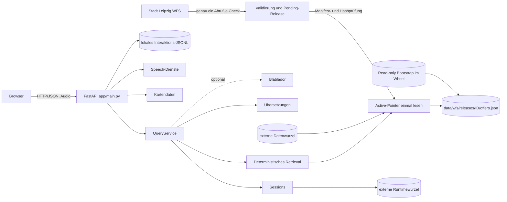

# Architektur

## Systemgrenze

LENA besteht aktuell aus einer einzelnen FastAPI-Anwendung mit statischem
Frontend und dateibasierter Persistenz. Es gibt keine separate Datenbank und
keinen separaten Frontend-Build. Die Anwendung beantwortet Nutzerfragen niemals
durch einen Live-Aufruf des WFS.

## Komponenten

`app/main.py` erzeugt die App, lädt die Wissensbasis, initialisiert Query- und
Speech-Dienste, startet optional die WFS-Hintergrundprüfung und registriert alle
Routen. Ein erfolgreicher automatischer Promote lädt die Wissensbasis neu.

`app/service.py` ist die fachliche Orchestrierung. Der Dienst löst Sessions auf,
behandelt Selbstbeschreibung, vage beziehungsweise fachfremde Fragen, wendet
Schlafplatz- und Zeitregeln an und entscheidet zwischen Blablador und Template.

`app/retrieval.py` normalisiert mehrsprachige Begriffe, erkennt Kategorie und
Zielgruppe und rankt `OfferRecord`-Objekte deterministisch. `app/temporal.py`
liefert eng begrenzte Hinweise für Essen, Medizin und Übernachtung; es behauptet
keine Echtzeitverfügbarkeit.

`app/providers/llm.py` implementiert zwei getrennte Modellschritte. Der Router
sieht einen kompakten Index und liefert validierte IDs sowie das verpflichtende
boolesche Signal `acute_risk_detected`. Bei `true` beendet `QueryService` den
normalen Pfad unmittelbar und gibt einen fest hinterlegten, sprachabhängigen
Hinweis auf 112 ohne Karten aus. Das LLM erkennt nur das Signal; Text,
Telefonnummer und Eskalationsziel bestimmt ausschließlich die Anwendung. Der
Formulator sieht nur bei `false` die ausgewählten vollständigen Datensätze. Eine
Nachprüfung blockiert nicht
belegte Zahlen, Zeiten, URLs, E-Mail-Adressen und Verfügbarkeitsaussagen.

Router und Formulator verwenden denselben asynchronen HTTPX-Transport, aber
getrennte Gesamtgrenzen von standardmäßig 15 beziehungsweise 30 Sekunden. Eine
Gesamtgrenze umschließt den tatsächlichen Netzwerkaufruf; HTTPX begrenzt
zusätzlich seine Transportphasen. Transportfehler werden nicht automatisch
wiederholt. Bei Timeout greift derselbe kontrollierte deterministische
beziehungsweise Template-Fallback wie bei anderen Providerfehlern.

`app/resources.py` löst statische Paketressourcen und den rein lesbaren
Bootstrap unabhängig vom aktuellen Arbeitsverzeichnis auf. Im Source-Checkout
bleiben `data/` und `runtime/` kompatible Standards. Eine Wheel-Installation
verwendet externe, konfigurierbare Daten- und Runtimewurzeln und schreibt nie in
`site-packages`. Der Bootstrap ist der einzige paketierte Startstand; ein
externer valider Active-Pointer hat Vorrang, Pending-Releases niemals.

`app/version.py` liest die kanonische Version aus den Paketmetadaten. Wheel,
FastAPI, CLI und Interaktionsprotokoll verwenden diesen Wert; nur ein nicht
installierter Source-Baum ohne Metadaten erhält die eindeutige Kennzeichnung
`0+unknown`. Interaktions- und WFS-Schema-Versionen bleiben getrennte Verträge.

`app/wfs_sync.py` validiert eine vollständige GeoJSON-FeatureCollection,
normalisiert Features und berechnet stabile Hashes. `app/wfs_releases.py`
schreibt daraus einen unveränderlichen Ordner mit `offers.json`,
`snapshot.geojson`, `diff.json` und typisiertem `manifest.json`. Promotion lädt
nicht erneut vom WFS, sondern prüft alle gespeicherten Bytes und ersetzt zuletzt
genau den kleinen Pointer `data/wfs/active_release.json` atomar. Rollback nutzt
denselben validierten Pointerwechsel. `app/kb_loader.py` liest den Pointer pro
Ladevorgang einmal und verwendet danach nur diesen Release; solange noch kein
Pointer existiert, bleibt `data/canonical/offers.json` ein Legacy-Fallback.

`app/i18n.py` führt deutsche Quelldaten, gespeicherte Übersetzungen und manuelle
Overrides zu Karten zusammen. Es liest einen vorhandenen externen Store oder
sonst den paketierten Bootstrap. `app/translate_offers.py` schreibt ausschließlich
in die externe Datenwurzel und aktualisiert den Store explizit als
Wartungsschritt, nicht während einer Nutzeranfrage.

`app/sessions.py` speichert eine begrenzte Anzahl kurzer Frage-/Antwortpaare in
`runtime/sessions.json`. Ein nach absolutem Pfad geteilter `RLock` umfasst im
Einzelprozess den gesamten Lese-Bereinigungs-Änderungs-Schreib-Zyklus. Writes
werden als eindeutige temporäre Datei im Zielordner geschrieben, mit `fsync`
gesichert und per `os.replace()` atomar aktiviert. TTL- und Kapazitätsbereinigung
laufen opportunistisch bei Sessionzugriffen. Beschädigtes JSON wird unter
`runtime/` als `sessions.corrupt.<Zeit>.<UUID>.json` quarantänisiert; ein
Persistenzfehler verhindert die fachliche Antwort nicht. Diese Mechanismen
koordinieren keine mehreren Prozesse oder Uvicorn-Worker. `app/maps.py`
transformiert WFS-Koordinaten aus
EPSG:25833 nach WGS84 und erstellt Ziele relativ zum Leipziger Hauptbahnhof.
`app/speech.py` kapselt externe Speech-Endpunkte und `edge-tts`.
Vor der Synthese ersetzt der Adapter das eigenständige Token `112`
sprachabhängig durch einzeln gesprochene Ziffern. Die visuelle API-Antwort bleibt
unverändert.

STT und TTS besitzen jeweils eine konfigurierbare Gesamtgrenze von standardmäßig
45 Sekunden. OpenAI-kompatible Aufrufe erhalten zusätzlich denselben HTTPX-
Transporttimeout. Bei Edge-TTS bricht Cancellation den lokalen asynchronen
Stream ab; LENA kann nicht garantieren, dass dadurch bereits begonnene Arbeit
des externen Dienstes beendet wird. Die Adapter erzeugen keine temporären
Audiodateien, sondern halten Request und Ergebnis im Speicher.

`app/interactions.py` trennt das lokale Forschungsprotokoll vom technischen
Logging. Der HTTP-Adapter schreibt nach dem finalen `QueryService`-Ergebnis
genau eine validierte UTF-8-JSONL-Zeile nach
`runtime/logs/interactions.jsonl`. Sie enthält die tatsächlich verarbeitete
Anfrage, die tatsächlich sichtbare Antwort, kurzlebige Session-ID, Sprache,
Eingabemodus, Antwortpfad, Quellen-IDs, Retrieval-Trefferzahl sowie Safety- und
Fallbackstatus und – bei pointerbasierten WFS-Daten – die tatsächlich für die
Antwort geladene `data_release_id`. Das Interaktionsschema besitzt deshalb
Version 2. Eine kleine Sperre schützt parallele Threads desselben
Prozesses; Schreibfehler werden redigiert geloggt und verändern die Antwort
nicht. Mehrprozesssynchronisierung, Rotation und ein Forschungsdaten-Backend
sind nicht implementiert.

Das technische Logging verwendet stabile Ereignisnamen für HTTP-Laufzeiten,
Router, Retrieval, Formulator, Fallback, Akutgefahr, Speech, Sessions, WFS und
Interaktions-Schreibfehler. Diese Logs enthalten absichtlich keine vollständigen
Anfragen oder Antworten. Das vollständige Interaktionsprotokoll ist davon
konfigurations- und dateiseitig getrennt.

Das Frontend baut Leaflet-Popups in `app/static/app.js` als DOM-Knoten auf.
Dynamische Labels und Adressen gelangen ausschließlich über `textContent` und
`createTextNode()` in diese Knoten. Die vendorte Leaflet-Version übernimmt
Nicht-String-Inhalte direkt per `appendChild`; WFS-, Wissensbasis- und
Übersetzungswerte werden daher im Popup nicht als HTML interpretiert. Für
spätere Popup-Erweiterungen gilt dieselbe Grenze: Text über DOM-Text-APIs,
Links nur nach expliziter Protokollprüfung.

## Tatsächliche Betriebsprofile

- Ohne Zugangsdaten: deterministische Antworten, keine Server-Transkription,
  Sprachsynthese über `edge-tts`, sofern Netzwerkzugriff möglich ist.
- Mit `REWRITE_PROVIDER=blablador`: zweistufige Modellverarbeitung mit
  vorgeschaltetem Akutgefahr-Signal und deterministischem Fallback bei jeder
  Provider- oder Validierungsstörung. Ohne funktionsfähigen LLM-Router findet
  keine Akutgefahr-Erkennung statt.
- Mit `WFS_AUTO_SYNC=true`: Prüfung beim Start und anschließend periodisch.
  `WFS_AUTO_PROMOTE=false` hält Änderungen zur manuellen Prüfung zurück.

## Konfigurationsabhängig

- Blablador benötigt Base-URL, API-Key und Modell.
- Server-STT benötigt einen OpenAI-kompatiblen Audio-Endpunkt.
- OpenAI-kompatibles TTS benötigt Endpunkt, Key und Modell; alternativ nutzt die
  Anwendung `edge-tts`.
- Kartenkacheln und `edge-tts` benötigen im Browser beziehungsweise Backend
  Netzwerkzugriff.
- Der WFS-Client verwendet standardmäßig 10 Sekunden für den Verbindungsaufbau
  und 30 Sekunden für das Lesen. Ein Timeout findet vor Validierung und Writes
  statt und lässt den aktiven Datenstand unverändert.

## Unvollständig oder bewusst nicht implementiert

- keine Kapazitäts-, Aufnahme- oder Echtzeitverfügbarkeitsdaten
- keine grafische Review-/Administrationsoberfläche für WFS und Übersetzungen
- keine prozessübergreifende Sperre für parallele WFS-Checks oder Promotionen;
  alte und verwaiste vollständige Releases werden nicht automatisch rotiert
- kein produktionsreifes Einwilligungs-, Zugriffs-, Aufbewahrungs-, Lösch-,
  Pseudonymisierungs- oder Anonymisierungskonzept für Interaktionsprotokolle
- keine prozessübergreifende Provider-Nebenläufigkeitsbegrenzung; mangels lokaler
  Modelle und belegter externer Kontingentgrenzen ist derzeit keine Semaphore
  implementiert
- keine Mehrbenutzer-, Mehrprozess- oder Datenbank-Persistenz für Sessions;
  Recovery-Dateien werden nicht automatisch rotiert oder gelöscht
- keine dokumentierte produktive Deployment-Orchestrierung, Authentifizierung,
  Rate-Limits oder TLS-Terminierung
- kein konfiguriertes Linter-, Type-Checker- oder Dokumentations-Buildsystem
- keine bitidentische Buildgarantie und kein plattformübergreifender Hash-Lock;
  Wheel/sdist-Inventar und Clean-Installation sind reproduzierbar geprüft
- keine Garantie, dass das LLM jede akute Gefahr erkennt oder Falschpositive
  vollständig vermeidet; die Übersetzungsentwürfe für Englisch, Polnisch,
  Rumänisch und Russisch benötigen noch menschliche Prüfung

Diese Punkte sind Einschränkungen des vorhandenen Codes, keine Zusage für eine
spätere Implementierung.
