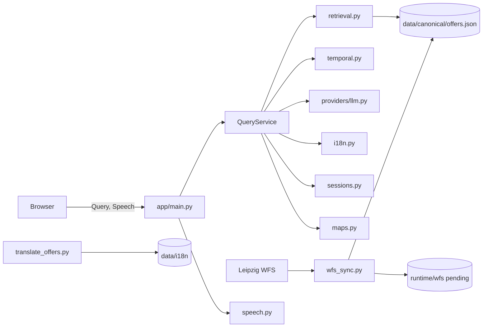

# Codebase-Review: LENA Code3

Stand: 2026-07-15

Statushinweis: Der in diesem Review beschriebene Popup-XSS-Pfad wurde am
2026-07-15 mit Modernisierungspaket 0A geschlossen. `app/static/app.js` erzeugt
die beiden Leaflet-Popups nun als DOM-Knoten und setzt dynamische Werte über
Text-APIs; `tests/test_frontend_security.py` schützt diese Verdrahtung statisch
gegen Regressionen. Die historischen Befunde bleiben als Begründung und
Ausgangslage des Plans erhalten. Ein ausführender Browser-E2E-Test steht mangels
lokaler JavaScript-/DOM-Testumgebung weiterhin aus.

Der zweite P0-Befund wurde am 2026-07-17 mit Modernisierungspaket 0B technisch
geschlossen. Der vorhandene LLM-Router liefert nun ein strikt validiertes
Akutgefahr-Signal; bei `true` ersetzt die Anwendung den normalen Antwortpfad
durch einen kontrollierten Hinweis auf 112. Die Erkennung bleibt von
LLM-Verfügbarkeit und -Bewertung abhängig. Die Übersetzungsentwürfe für
Englisch, Polnisch, Rumänisch und Russisch sind noch menschlich zu prüfen.

Der Git-/CI-Befund wurde am 2026-07-17 mit Modernisierungspaket 1 geschlossen.
Der geprüfte Stand wurde über PR #1 in `main` des GitHub-Repositories
`lena-grounded-voice-assistant` übernommen. Der Commit `43b88bc` bildet die
Code3-Baseline auf Basis der erhaltenen v1/v2-Historie ab. GitHub Actions führt
Pytest, `compileall` und einen Clean-Wheel-Smoke aus; die Remote-Läufe des
Baseline-PRs waren erfolgreich. Das Wheel enthält Frontend und aktive Daten.

Modernisierungspaket 2 schließt am 2026-07-17 die Request- und
Expositionsbefunde: Query, STT und TTS besitzen serverseitige Grenzen; STT wird
begrenzt gestreamt, TTS nutzt einen typisierten Vertrag, und nicht lokale Hosts
benötigen zusätzlich `--allow-public`. Historische Aussagen dieses Reviews
bleiben als Ausgangsbefund lesbar, sind aber nicht mehr der aktuelle Stand.

## 1. Executive Summary

`Code3/` ist ein kompakter, grundsätzlich nachvollziehbarer Prototyp mit einer
einzigen FastAPI-Anwendung, einem statischen Browser-Frontend und dateibasierter
Persistenz. Die fachliche Kernidee ist stark: Nutzerantworten werden aus einem
lokalen, validierten WFS-Datenstand abgeleitet; ein optionales Sprachmodell darf
nur routen und formulieren. Deterministische Fallbacks, Pydantic-Verträge,
Grounding-Prüfungen, WFS-Validierung und 81 bestandene Tests bilden eine gute
Basis für die weitere Entwicklung.

Der aktuelle Stand ist jedoch noch kein belastbarer Entwicklungs- oder
Produktionsstand. Die wichtigsten Ursachen sind:

- Die Code3-Baseline ist im bestehenden LENA-Repository versioniert, remote
  geprüft und über PR #1 in `main` übernommen.
- Das gebaute Wheel enthält Frontend und aktive Laufzeitdaten und wird in CI aus
  einer frischen Umgebung geprüft.
- Der im Review bestätigte Stored-XSS-Pfad in Leaflet-Popups ist durch Paket 0A
  geschlossen; ein Browser-E2E-Sicherheitsnetz fehlt noch.
- Ein validiertes LLM-Akutgefahr-Signal führt zu einem kontrollierten Hinweis
  auf 112; LLM-Erkennungsfehler und ungeprüfte Übersetzungsentwürfe bleiben.
- WFS-Review und Promotion beziehen sich nicht zwingend auf denselben Payload;
  die Aktivierung mehrerer Dateien ist nicht als Gesamtvorgang atomar.
- Sessionwachstum, direkte Writes und Parallelzugriffe innerhalb eines Prozesses
  sind durch Paket 4 begrenzt; mehrere Prozesse bleiben ausdrücklich unkoordiniert.
- Fehler und Fallbacks sind mangels strukturiertem Logging betrieblich kaum
  sichtbar.
- Zentrale Dateien und Funktionen bündeln zu viele Verantwortlichkeiten.

Empfohlen wird kein Komplettumbau. Zuerst werden Sicherheits- und
Reproduzierbarkeitslücken geschlossen, danach Persistenz und Beobachtbarkeit,
anschließend Packaging und Tests. Erst auf dieser abgesicherten Basis sollten
Backend und Frontend schrittweise entlang ihrer vorhandenen Verantwortlichkeiten
geteilt werden.

## 2. Aktueller Systemaufbau

### 2.1 Technologien und Packaging

| Bereich | Tatsächlicher Stand |
|---|---|
| Sprache | Python >= 3.11, JavaScript, HTML, CSS |
| Backend | FastAPI und Uvicorn |
| Verträge | Pydantic 2 |
| HTTP-Clients | `httpx` |
| TTS | `edge-tts` oder OpenAI-kompatibler Endpunkt |
| Frontend | statische Dateien ohne Build-Schritt |
| Karten | vendored Leaflet 1.9.4, OSM-Tiles |
| Tests | Pytest, FastAPI `TestClient` |
| Build | setuptools über `pyproject.toml` |
| Persistenz | JSON/GeoJSON unter `data/` und `runtime/` |

`pyproject.toml` deklariert `lena-code3` 0.1.0. Die FastAPI-Anwendung meldet
0.2.0. Ein Test-Wheel ließ sich bauen, enthielt aber ausschließlich Python-
Module und Metadaten. `app/static/` und alle Daten unter `data/` fehlten. Die
editable Installation aus dem Arbeitsverzeichnis verdeckt dieses Problem.

### 2.2 Komponenten und Verantwortlichkeiten



| Komponente | Verantwortung | Bewertung |
|---|---|---|
| `app/main.py` | App-Factory, Lifecycle, Routen, Hintergrundtask | funktional, aber Komposition und Adapter vermischt |
| `app/service.py` | Session, Schutzregeln, Routing, Retrieval, LLM, Fallback, Karten | zentral und testbar, aber überladen |
| `app/retrieval.py` | mehrsprachiges deterministisches Ranking | direkt wiederverwendbar |
| `app/temporal.py` | eng begrenzte Zeitregeln | fachlich sinnvoll abgegrenzt |
| `app/providers/llm.py` | Router, Formulator, HTTP, Validierung | gutes Sicherheitskonzept, zu viele Ebenen in einer Klasse |
| `app/wfs_sync.py` | Fetch, Validierung, Normalisierung, Diff, Staging, Promotion | wertvoll, aber transaktional unvollständig |
| `app/i18n.py` | Translation-Store, Hashstatus, Overrides | direkt wiederverwendbar |
| `app/translate_offers.py` | Übersetzungs-CLI und Provideraufruf | sinnvoll erweiterbar |
| `app/sessions.py` | JSON-Sessions | problematisch für Parallelität und Wachstum |
| `app/maps.py` | EPSG-Transformation und Kartenziele | wiederverwendbar, mathematisch isoliert |
| `app/speech.py` | STT- und TTS-Adapter | klein genug, aber ohne Eingabegrenzen |
| `app/static/app.js` | gesamter Browserzustand und alle UI-Adapter | funktionsfähig, stark überladen |

## 3. Tatsächliche Laufzeitpfade

### 3.1 Start und Konfiguration

1. `python -m app` ruft `app.__main__.main()` auf.
2. Uvicorn verwendet `app.main:create_app` als Factory.
3. `load_settings()` liest `.env`, danach `.env.local` mit Override-Priorität.
4. `create_app()` lädt `settings.kb_path`, standardmäßig
   `data/canonical/offers.json`.
5. `QueryService`, Speech-Adapter und optional der WFS-Hintergrundtask werden
   erzeugt.
6. `app/static/` wird unter `/static` gemountet; `/` liefert `index.html`.

Die produktive Wissensbasis ist WFS-normalisiertes JSON. Der Markdown-Parser in
`app/kb_loader.py` bleibt ein erreichbarer alternativer Importpfad über
`LENA_KB_PATH` und wird durch Tests abgedeckt. Er ist daher kein bestätigter
toter Code, aber nicht der Standardpfad.

### 3.2 Nutzeranfrage

1. `app/static/app.js:submitQuery()` sendet `POST /api/query`.
2. Pydantic normalisiert `QueryRequest.query` und begrenzt ihn auf 1000 Zeichen.
3. `QueryService.query()` löst eine Session auf und delegiert an `_query_core()`.
4. Schutz-, Selbstbeschreibungs- und Klärungspfade laufen vor Retrieval/LLM.
5. Wenn Blablador konfiguriert ist, sieht der Router einen kompakten Index und
   liefert validierte Angebots-IDs sowie `acute_risk_detected`.
6. Bei Akutgefahr liefert die Anwendung sofort den festen 112-Hinweis; andernfalls
   erhält der Formulator nur ausgewählte vollständige Records.
7. Zahlen, Zeiten, URLs, E-Mail-Adressen, IDs und Verfügbarkeitsaussagen werden
   nachvalidiert. Fehler führen zum Template-Pfad.
8. Karten werden lokalisiert, Kartenziele erzeugt und die Session gespeichert.
9. Das Frontend rendert Text, Karten, Verlauf und Leaflet-Karte.

Alle registrierten nutzerbezogenen Endpunkte werden vom Frontend konsumiert:
`/api/query`, `/api/speech/config`, `/api/speech/transcribe` und
`/api/speech/synthesize`. `/api/health` ist ein plausibler Betriebsendpunkt ohne
Frontend-Verbraucher. Es gibt keinen bestätigten verwaisten HTTP-Endpunkt.

### 3.3 WFS-Prüfung und Promotion

`sync_wfs()` ruft bei jedem Lauf den Live-WFS ab. Es validiert die komplette
FeatureCollection, normalisiert Records und berechnet Diff und Hashes. `--check`
schreibt Pending-Dateien. `--promote` ruft den WFS erneut ab und aktiviert diesen
neu abgerufenen Stand; es übernimmt nicht den zuvor geprüften Pending-Payload.

Die einzelnen JSON-Schreibvorgänge nutzen temporäre Dateien und `replace()`.
Die Gruppe aus Raw-GeoJSON, Canonical-JSON, Report, Snapshot,
Übersetzungsstatus und State besitzt jedoch keine Transaktion. Ein Fehler nach
dem Canonical-Write kann einen gemischten Datenstand hinterlassen.

### 3.4 Übersetzungen

`QueryService` lädt Translation-Store und manuelle Overrides beim Erzeugen des
Dienstes. `python -m app.translate_offers` aktualisiert Dateien separat. Ein
laufender Prozess lädt diese Änderung nicht automatisch neu. Nach einer
Übersetzungswartung ist deshalb aktuell ein App-Neustart oder eine anderweitige
Service-Neuerzeugung erforderlich.

### 3.5 Speech und Karten

Speech-Endpunkte lesen den vollständigen Request-Body beziehungsweise Text ohne
anwendungsspezifische Größenbegrenzung. STT und OpenAI-TTS verwenden
OpenAI-kompatible HTTP-Endpunkte; Edge-TTS ist der Standard. Providerfehler werden
als HTTP 503 vereinheitlicht.

Kartenziele werden serverseitig nach WGS84 transformiert. Das Frontend lädt
OSM-Tiles und bindet Popup-Inhalte seit Paket 0A als sichere DOM-Knoten ein.

## 4. Positive bestehende Strukturen

### 4.1 Direkt wiederverwendbar

- Pydantic-Modelle in `app/models.py` als zentrale API- und Datengrenze.
- App-Factory `create_app(settings)` für isolierte Tests.
- Deterministisches Retrieval mit strukturiertem `RetrievalOutcome`.
- Getrennte Zeitregeln in `app/temporal.py`.
- Zweistufiger LLM-Pfad mit ID-Whitelist und Grounding-Prüfung.
- Fehlerklassen `KnowledgeBaseError`, `ProviderError`, `WfsSyncError` sowie
  Speech-spezifische Fehler.
- Atomarer Einzeldatei-Writer in `app/wfs_sync.py` und `app/i18n.py`.
- Content-Hashes und feldbezogene WFS-Diffs.
- Translation-Hashes und manuelle Overrides.
- Lokale Testfixture statt Live-WFS in der Testausführung.
- DOM-Ausgabe überwiegend über `textContent`, wodurch viele XSS-Pfade bereits
  vermieden werden.

### 4.2 Sinnvoll erweiterbar

- `Settings` als Konfigurationsgrenze, nach Aufteilung des langen Loaders.
- `KnowledgeBase` als lesendes Repository; `by_id()` sollte künftig einmalig
  indiziert statt wiederholt aufgebaut werden.
- `SpeechTranscriber` und `SpeechSynthesizer` als vorhandene Providergrenzen.
- `WfsPaths` als Grundlage für einen klaren Staging-/Promotion-Vertrag.
- Deutsche Dokumentationsstruktur unter `docs/`.

### 4.3 Problematisch gekoppelt

- `QueryService` kennt Sessions, Übersetzungsdateien, LLM, Retrieval,
  Fachregeln, Karten und Response-Anreicherung.
- `create_app()` enthält Lifecycle, Hintergrundjob, Fehlerpolitik und Routen.
- `BlabladorProvider` kombiniert Transport, Promptbau, Schema- und
  Groundingvalidierung.
- `app/static/app.js` kombiniert Copy, Zustand, Navigation, Rendering, Karte,
  Browser-STT, Server-STT und TTS.

## 5. Technische Schulden und Codequalität

### 5.1 Struktur, Größe und Kohäsion

| Befund | Beleg | Bewertung |
|---|---|---|
| Frontend-Monolith | `app/static/app.js`, 972 Zeilen | P2 |
| überladener Anwendungsdienst | `app/service.py`, 501 Zeilen; `_query_core()` 196 Zeilen | P1 |
| breite Sync-Pipeline | `app/wfs_sync.py`, 417 Zeilen; `sync_wfs()` 67 Zeilen | P1 |
| lange Provider-Methoden | `route()` 87, `answer()` 82 Zeilen | P2 |
| lange Konfigurationsfunktion | `load_settings()` 110 Zeilen | P2 |
| Testkonzentration | `tests/test_api.py`, 672 Zeilen, 31 Testfunktionen | P2 |

Die Überschreitungen rechtfertigen eine Prüfung, aber keine mechanische Teilung.
Sinnvolle Grenzen sind Fachpolitik, Orchestrierung, Transport, Persistenz und UI-
Adapter.

### 5.2 Typisierung und öffentliche Schnittstellen

Python-Typannotationen und Pydantic sind breit vorhanden. Schwächer typisiert
sind insbesondere rohe `dict[str, object]`-Payloads der Speech-Route,
Routing-Kontexte und JSON-Stores. Es ist kein Type-Checker konfiguriert. Die
öffentliche HTTP-Oberfläche ist klein, aber nicht separat versioniert oder als
stabiler Vertrag dokumentiert.

### 5.3 Fehlerbehandlung und Logging

Fallbacks schützen Nutzer vor Providerfehlern, verbergen aber gleichzeitig die
Ursache. Besonders relevant:

- `main.wfs_loop()` fängt jedes `Exception` und speichert nur `{"status":
  "error"}`.
- `QueryService` fängt `ProviderError` an mehreren Stellen ohne strukturierte
  Diagnose.
- `_load_all()` überspringt beschädigte Sessioneinträge still.
- Edge-TTS fängt pauschal `Exception`.

Es existiert kein Anwendungslogger, keine Korrelations-ID, keine Metrik und kein
redigiertes Fehlerereignis. Ein moderner Stand benötigt beobachtbare Fallbacks,
ohne Keys oder Nutzereingaben unkontrolliert zu loggen.

### 5.4 Konfiguration und Secrets

`.env` und `.env.local` sind ignoriert und wurden im Review nicht gelesen.
`.env.local` überschreibt durch `_load_env_file(..., override=True)` sogar
bereits gesetzte Prozessvariablen. Das ist für lokale Entwicklung praktisch,
für Deployment jedoch überraschend und kann zentral gesetzte sichere Werte
aushebeln. Es fehlt eine explizite Environment-/Profilentscheidung.

Der WFS-HTTP-Timeout von 30 Sekunden ist hart codiert. OSM-Tile-URL,
Hauptbahnhof-Koordinaten und einige fachliche Texte sind ebenfalls direkt im
Code. Nicht jeder harte Wert braucht Konfiguration; Betriebswerte und fachliche
Policies sollten aber getrennt und getestet werden.

### 5.5 Persistenz, Nebenläufigkeit und Ressourcen

- Sessions werden weiterhin vollständig gelesen und vollständig neu geschrieben,
  seit Paket 4 jedoch unter einem prozessweit geteilten Pfad-Lock und per
  Tempdatei plus atomarem `os.replace()`.
- TTL- und Kapazitätspruning begrenzen den aktiven Bestand; Recovery-Dateien
  beschädigter Stände benötigen weiterhin eine bewusste lokale Aufbewahrung.
- Ein Mehrprozess-Uvicorn-Betrieb kann weiterhin Updates verlieren, weil der
  Lock absichtlich nur innerhalb eines Prozesses gilt.
- WFS-Promotion ist nur pro Datei atomar.
- STT und TTS besitzen seit Paket 2 explizite, getestete Request-Grenzen.
- HTTP-Clients werden pro Aufruf neu erzeugt; bei der kleinen Last ist dies kein
  akutes Problem, sollte aber bei einem Betriebsziel neu bewertet werden.

### 5.6 Abhängigkeiten, Build und Deployment

- Direkte Abhängigkeiten sind begrenzt und mit Major-Version-Obergrenzen
  versehen.
- Python-3.11-Constraints fixieren die getestete Auflösung, enthalten jedoch
  noch keine Artefakthashes.
- Das Wheel enthält Frontend und aktive Daten; der frühere Packaging-Dead-End
  ist technisch geschlossen.
- Es gibt inzwischen minimale Python-CI, aber weiterhin keine Container-,
  Service-, TLS- oder Deploymentkonfiguration.
- `pyproject.toml` beschreibt den Stand noch als „Markdown-grounded“.
- Paketversion 0.1.0 und API-Version 0.2.0 sind inkonsistent.

### 5.7 Barrierefreiheit und Lokalisierung

Positiv sind semantische Buttons, Labels, Fokus-Stile, `aria-live`,
Screenreader-Texte und fünf Sprachvarianten. Offene Punkte:

- `<html lang="de">` wird beim Sprachwechsel nicht angepasst.
- Die Kartenbeschriftung `aria-label` bleibt Deutsch.
- Leaflet-Popups und externe Kartenkacheln wurden nicht automatisiert auf
  Tastatur- und Screenreader-Nutzung geprüft.
- Es gibt keine Browser- oder Accessibility-Test-Suite.
- Maschinelle Übersetzungen sind technisch versioniert, fachliche
  Review-Vollständigkeit ist aber kein hartes Release-Gate.

### 5.8 Performance

Für den kleinen Datenbestand ist lineares Retrieval nachvollziehbar. Wiederholte
Aufrufe von `KnowledgeBase.by_id()` bauen jedoch mehrfach Dictionaries auf.
JSON-Sessions skalieren mit der Gesamtzahl gespeicherter Sessions. Beides ist
kein P0, sollte aber vor einem Mehrnutzerbetrieb adressiert werden.

## 6. Dead Ends

| Prio | Möglicher/Bestätigter Dead End | Beleg | Auswirkung und Risiko | Empfohlene Maßnahme | Verifikation | Sicherheit |
|---|---|---|---|---|---|---|
| P0 | Stored-XSS in Karten-Popups | `app/static/app.js:renderMap()` interpoliert `origin.label`, `origin.address`, `destination.label` und `destination.address` in `bindPopup()`-HTML | Externe WFS-/Übersetzungswerte können HTML/Script in den Browser bringen | DOM-Nodes oder konsequentes Escaping; CSP ergänzend prüfen | Browser-/DOM-Test mit `` als Datenwert | hoch |
| P0 | Akutgefahr endete ohne Eskalationsinformation (durch Paket 0B technisch geschlossen) | `LLMRoute.acute_risk_detected`, früher Return in `QueryService._query_core()`, `tests/test_safety.py` | LLM kann Gefahr weiter übersehen oder fälschlich melden; vier Sprachfassungen sind Entwürfe | Übersetzungen menschlich prüfen und Providerqualität beobachten | parametrisierte API-, Vertrags- und TTS-Tests; kontrollierter Provider-Smoke | hoch für Implementierung, LLM-Qualität extern |
| P1 | Geprüfter WFS-Stand ist nicht der promotete Stand | `sync_wfs()` ruft sowohl bei `--check` als auch `--promote` `fetch_wfs()` auf | Daten können sich zwischen Review und Aktivierung ändern | Promotion anhand Content-Hash eines Pending-Artefakts; neuer Check bei Abweichung | Test: Quelle ändert sich zwischen Check und Promote | hoch |
| P1 | Multi-Datei-Promotion kann Mischstand erzeugen | sequenzielle `_atomic_json()`-Aufrufe, danach Translation-Update und Cleanup | Neustart oder laufender Prozess kann inkonsistente Artefakte sehen | Release-Verzeichnis/Manifest und atomarer Zeigerwechsel oder Recovery-Protokoll | Fault-Injection nach jedem Promotionsschritt | hoch |
| P1 | Gebautes Wheel ist nicht lauffähig | Test-Wheel enthält weder `app/static/` noch `data/` | Installation funktioniert nur editable aus Checkout | Paketdatenstrategie festlegen; Datenpfade über Resources/externes Datenverzeichnis | Wheel in leerer Umgebung installieren und App/Frontend starten | hoch |
| P1 | Sessionablage verliert oder beschädigt Daten (für Einzelprozess in Paket 4 geschlossen) | `SessionStore` sperrt den vollständigen Zyklus und aktiviert per `os.replace()`; kein Mehrprozess-Lock | parallele Requests eines Prozesses sind geschützt, mehrere Worker können sich weiterhin überschreiben | Einzelprozessbetrieb beibehalten oder vor Mehrprozessbetrieb koordinierten Store einführen | `tests/test_session_persistence.py`; später Mehrprozess-Integrationstest | hoch für Einzelprozess, offene Mehrprozessgrenze |
| P1 | Abgelaufene Sessions werden nie entfernt (in Paket 4 geschlossen) | opportunistisches TTL-Pruning und `SESSION_MAX_ENTRIES` im produktiven Store | aktive JSON-Map ist begrenzt; Recovery-Dateien werden nicht automatisch gelöscht | lokale Recovery-Aufbewahrung betrieblich festlegen | TTL-, Kapazitäts- und Recoverytests | hoch |
| P1 | Fallbacks maskieren Betriebsfehler | pauschale/lautlose `except`-Pfade in `main.py`, `service.py`, `sessions.py`, `speech.py` | Health kann eingeschränkt bleiben, Ursache fehlt; Fehler wiederholen sich unbemerkt | strukturiertes, redigiertes Logging und Health-Fehlercodes | Tests mit `caplog`; Smoke-Test bei Provider-/WFS-Ausfall | hoch |
| P1 | Unbegrenzte Speech-Requests (geschlossen in Paket 2) | historisch `request.body()` in `main.py`; kein Audio-/Textlimit | Speicher-/Kostenmissbrauch bei externer Bindung | begrenztes Streaming, typisierter TTS-Vertrag und 413/415/422-Vertrag implementiert; Proxy-Limits bleiben Betriebsaufgabe | `tests/test_request_boundaries.py` knapp unter/über Grenze und chunked | hoch |
| P2 | Übersetzungs-CLI aktualisiert laufenden Dienst nicht | Stores nur in `QueryService.__init__()` geladen | Wartung wirkt erst nach nicht dokumentiertem Neustart | expliziter Reload/Versionwatch oder dokumentierter Restart | Integrationstest Translation vor/nach Reload | hoch |
| P2 | `full_context_recommended` ist wirkungslos | nur in `retrieval.py` gesetzt, nirgends gelesen | irreführendes Architekturversprechen | entfernen oder in klaren Routingentscheid integrieren | Referenzsuche und Verhaltenstest | hoch |
| P2 | `kb_error`-State ist wirkungslos | in `main.py` gesetzt, nicht gelesen | tote Zustandsvariable, erschwert Diagnose | Health explizit nutzen oder entfernen | Referenzsuche/API-Test | hoch |
| P2 | `pending_clarification` wird gespeichert, aber nicht verwendet | `sessions.py` schreibt Feld; keine Leseentscheidung | scheinbare Sessionfunktion ohne Wirkung | fachlichen Nutzen definieren oder Feld entfernen/migrieren | Folgefragetests | hoch |
| P2 | Markdown- und WFS-Pfade können dauerhafte Parallelarchitektur werden | `load_knowledge_base()` unterstützt beide, Standard ist WFS | doppelte Datenverträge und Pflegeaufwand | Status als Importadapter festlegen; Deprecation erst nach Migrationsentscheidung | Tests und Konfigurationsinventar | mittel |
| P2 | Frontend-Monolith blockiert sichere Erweiterung | `app/static/app.js` 972 Zeilen | Speech, Zustand, Rendering und Karte beeinflussen sich | ohne Frameworkzwang in kohäsive ES-Module teilen | Browser-Smoke-/E2E-Tests vor und nach Teilung | hoch |
| P3 | Gesundheitsfelder sind redundant | `llm_router_available` und `full_context_fallback_available` erhalten denselben Wert | unklarer Vertrag | Semantik dokumentieren oder einen Alias deprecaten | Contract-Test | hoch |
| P3 | `--check` wird geparst, aber nicht ausgewertet | Default ist ohnehin `promote=False` | geringe CLI-Irritation | expliziten Modusvertrag vereinfachen | CLI-Test | hoch |

Nicht als Dead End bestätigt wurden unregistrierte Python-Module, fehlende HTML-
IDs oder unverdrahtete nutzerbezogene Endpunkte. Import-Smoke-Test und
HTML/JavaScript-ID-Abgleich waren erfolgreich.

## 7. Sicherheits- und Stabilitätsrisiken

### P0

1. **Popup-XSS:** technisch reproduzierbarer HTML-Injektionspfad.
2. **Akutgefahr:** technischer 112-Pfad ist umgesetzt; LLM-Erkennungsqualität
   und menschliche Freigabe von vier Übersetzungsentwürfen bleiben offen.

### P1

- Review/Promote-Identität und Recovery der WFS-Daten.
- Session-Datenintegrität, Retention und mögliche personenbezogene Inhalte.
- Request-Limits bei Speech sind seit Paket 2 implementiert; Proxy-Limits und
  Rate-Limiting bleiben Betriebsaufgaben.
- unvollständiges Distributionsartefakt.
- fehlende beobachtbare Fehler- und Fallbackereignisse.
- der neue Baseline-Branch ist noch nicht remote geteilt oder durch einen Pull
  Request reviewt.

### Weitere Sicherheitsbeobachtungen

- Standardbindung ist lokal (`127.0.0.1`). Seit Paket 2 erfordert ein nicht
  lokaler `--host` zusätzlich `--allow-public`; das Flag stellt weiterhin weder
  Authentifizierung, Rate-Limiting, Trusted-Host-Prüfung noch TLS bereit.
- `/api/health` gibt keine Secrets aus; das ist positiv.
- `.env` und `.env.local` wurden bewusst nicht gelesen.
- Im ursprünglichen Review konnte mangels Code3-Historie nicht geprüft werden,
  ob lokale Geheimnisse früher anderweitig geteilt wurden. Die neue Baseline
  enthält laut Indexscan keine erkannten produktiven Geheimnisse; dies ersetzt
  keine Prüfung externer oder verlorener Historien.
- Nutzerdaten werden an Blablador/Speech-Dienste gesendet, wenn konfiguriert.
  Ein dokumentierter Datenschutz- und Einwilligungsrahmen fehlt.

## 8. Test- und Dokumentationslücken

### Bestehende Tests

Die Suite umfasst nach Paket 0A und 0B 81 ausgeführte Fälle:

- API, Provider, Grounding und Fallbacks: `tests/test_api.py`
- KB-Loader: `tests/test_kb_loader.py`
- Retrieval: `tests/test_retrieval.py`
- Sessions: `tests/test_sessions.py`
- WFS: `tests/test_wfs_sync.py`
- Akutgefahr, Routervertrag und 112-TTS: `tests/test_safety.py`

Alle Tests bestanden. `compileall` und Import-Smoke-Test waren erfolgreich.

### Wesentliche Lücken

- kein kontrollierter Live-/Sandbox-Nachweis der LLM-Erkennungsqualität
- kein ausführender Browser-XSS-/DOM-Sicherheitstest
- keine JavaScript-Unit- oder Browser-End-to-End-Tests
- keine dedizierten Tests für `maps.py`, `temporal.py`, `i18n.py`,
  `translate_offers.py` und reale Speech-Fehlerverträge außerhalb API-Mocks
- kein Check/Promote-Identitätstest und keine Fault-Injection für Promotion
- keine Parallelitäts-, Retention- oder Korruptionstests für Sessions
- Wheel-Installations-/Packaging-Smoke-Test ist in GitHub Actions vorhanden
- keine Accessibility-Automation
- keine Coverage-Messung, kein Linter, Formatter oder Type-Checker
- Remote-CI ist für die Baseline bestätigt

Die Provider-Tests prüfen sinnvoll Prompt, IDs und Grounding, ersetzen aber den
realen externen Dienst. Contract-/Sandbox-Tests gegen einen kontrollierten
OpenAI-kompatiblen Stub wären belastbarer als Tests gegen Live-Dienste.

Die vorhandene Dokumentation ist deutlich besser als der ursprüngliche Stand.
Noch unvollständig oder ungenau sind Neustart nach Translation,
Review/Promote-Semantik, das öffentliche Betriebsprofil und die unterschiedliche
Versionsangabe.

## 9. Empfohlenes Zielbild

### 9.1 Leitprinzipien

- Eine Anwendung und ein kanonischer Runtime-Datenvertrag.
- Fachlogik bleibt deterministisch und unabhängig von FastAPI, Dateisystem und
  externen Providern testbar.
- Abhängigkeiten zeigen von Adaptern zur Fachlogik, nicht umgekehrt.
- Kleine Protokolle nur an echten Austauschgrenzen; kein generisches Repository-
  Framework.
- Jede externe Wirkung besitzt Timeout, Größenlimit, redigiertes Logging und
  definierten Fallback.
- Handgeschriebene Dateien bleiben möglichst unter 400 Zeilen; Teilung erfolgt
  nach Verantwortung.

### 9.2 Gewünschte Modulgrenzen

```text
app/
  main.py                 App-Factory und Komposition
  api/                    HTTP-Routen und Request-/Response-Adapter
  domain/                 Fachregeln, Retrieval, Temporal-, Schlaf- und Safety-Policy
  services/               Query-Orchestrierung und Use Cases
  providers/              LLM- und Speech-Clients
  storage/                KB-, Session-, Translation- und WFS-Release-Zugriff
  static/                 kleine ES-Module ohne Buildzwang
```

Dies ist eine Zielrichtung, kein Auftrag zur sofortigen Verzeichnismigration.
Zunächst sollten Verantwortlichkeiten innerhalb vorhandener Pfade extrahiert
werden. Ein neues Paket entsteht nur, wenn mindestens zwei Module davon
profitieren und Importzyklen vermieden werden.

### 9.3 Abhängigkeitsrichtung

1. Pydantic-/Domain-Modelle kennen keine FastAPI- oder HTTP-Clients.
2. Fachregeln arbeiten auf Modellen und reinen Werten.
3. Services orchestrieren Fachregeln über kleine Provider-/Storage-Protokolle.
4. Adapter implementieren HTTP, Dateien und externe Dienste.
5. `main.py` verdrahtet konkrete Implementierungen.

### 9.4 Konfiguration

- Eine validierte Settings-Struktur mit dokumentierter Priorität.
- `.env.local` überschreibt Prozesswerte nur in explizitem Entwicklungsmodus.
- Betriebswerte wie WFS-Timeout, Request-Limits und Retention sind konfigurierbar
  mit sicheren Grenzen.
- Fachliche Policies werden benannt, versioniert und getestet, nicht beliebig
  als Umgebungsvariable freigegeben.

### 9.5 Fehlerbehandlung und Logging

- Domänenspezifische Fehler bleiben erhalten.
- API-Adapter übersetzen Fehler in stabile, nicht sensible Fehlercodes.
- Strukturierte Logs enthalten Event, Provider, Dauer, Fallbackgrund und
  Korrelations-ID, aber keine Tokens und standardmäßig keine Nutzertexte.
- Health unterscheidet `healthy`, `degraded` und `unavailable`.

### 9.6 Typisierung und öffentliche Schnittstellen

- `mypy` oder `pyright` schrittweise im bestehenden Code aktivieren.
- Rohe Dict-Payloads an API-/Store-Grenzen durch kleine Modelle ersetzen.
- HTTP-Verträge durch API-Tests stabilisieren; Breaking Changes benötigen
  Versionierung oder Deprecation.
- Öffentliche Python-Exporte auf tatsächlich verwendete Adapter beschränken.

### 9.7 Teststrategie

1. Reine Fachtests für Safety, Retrieval, Temporal und Rollen.
2. Service-Tests mit expliziten Fake-Providern und In-Memory-Stores.
3. Adaptertests für Dateien, WFS und OpenAI-kompatible HTTP-Stubs.
4. FastAPI-Contract-Tests.
5. wenige Browser-E2E-Smokes für Sprache, Query, Karten und Accessibility.
6. Wheel-Installations- und Start-Smoke-Test in CI.

### 9.8 Externe Dienste und Persistenz

- Wiederholungen nur für idempotente Transportfehler, mit begrenztem Backoff.
- Keine automatischen Retries für fachlich/vertraglich ungültige Antworten.
- WFS-Pending-Artefakte werden per Hash freigegeben.
- Promotion erzeugt einen unveränderlichen Release-Stand und schaltet einen
  atomaren Zeiger um.
- Sessions erhalten atomare Writes, Retention und eine klar dokumentierte
  Einzelprozessgrenze; erst bei echtem Mehrprozessbedarf ist SQLite sinnvoll.

### 9.9 Statische, generierte und vendored Dateien

- `app/static/vendor/` wird nicht manuell formatiert; Version und Quelle werden
  dokumentiert.
- `runtime/`, Caches und lokale Secrets bleiben generiert/ignoriert.
- Aktivierte WFS-/i18n-Artefakte erhalten klaren Source-of-Truth- und
  Reviewstatus.
- Das Distributionsformat enthält Frontend und einen definierten initialen
  Datenstand oder verlangt einen explizit konfigurierten externen Datenpfad.

## 10. Priorisierte Handlungsempfehlungen

| Prio | Empfehlung | Nutzen | Risiko der Änderung | Aufwand | Vorarbeiten | Mögliche Regressionen |
|---|---|---:|---:|---:|---|---|
| P0 | Popup-Rendering ohne HTML-Interpolation | sehr hoch | niedrig | klein | DOM-Testfixture | Popup-Formatierung |
| P0 | Akutgefahr-Pfad betreiben und Sprachentwürfe freigeben | sehr hoch | niedrig | klein | menschliches Übersetzungsreview, Providerbeobachtung | LLM-Falschpositive/-negative |
| P1 | Baseline-Branch per Pull Request reviewen und remote absichern (geschlossen) | sehr hoch | niedrig | klein | Push-Freigabe | Remote-Checks oder Mergekonflikte |
| P1 | Speech-Größenlimits und Expositionsgrenze (geschlossen in Paket 2) | hoch | niedrig | klein | Grenzwerte definieren | große legitime Audios |
| P1 | strukturiertes redigiertes Logging | hoch | niedrig | mittel | Event-/Datenschutzschema | Lograuschen |
| P1 | Session-Write, Lock und Retention absichern | hoch | mittel | mittel | Retention festlegen | Sessionverlust bei Migration |
| P1 | hashgebundene transaktionale WFS-Promotion | sehr hoch | mittel–hoch | mittel | Releasevertrag | Update-/Recoverypfad |
| P1 | vollständiges Wheel und Versionsquelle | hoch | mittel | mittel | Datenstrategie | Pfadauflösung |
| P2 | Safety-/Temporal-/Map-/i18n-Testlücken schließen | hoch | niedrig | mittel | stabile Fixtures | strengere Tests decken Istfehler auf |
| P2 | `QueryService` nach Policy und Orchestrierung teilen | hoch | mittel | mittel | Characterization-Tests | Fallback-Reihenfolge |
| P2 | LLM-Transport, Prompt und Validator trennen | mittel–hoch | mittel | mittel | Provider-Contract-Tests | Prompt-/Fehlersemantik |
| P2 | Frontend in API, State, Rendering, Map und Speech teilen | hoch | mittel | mittel–hoch | Browser-Smokes | Event-/Sessionzustand |
| P2 | Settings validieren und Umgebungspriorität klären | mittel | mittel | mittel | Betriebsprofile | lokale Konfiguration |
| P2 | CI mit Tests, Lint, Typen und Wheel-Smoke | hoch | niedrig | mittel | Git-Repository | neue Quality-Gates |
| P3 | kleine Performance- und API-Bereinigungen | gering–mittel | niedrig | klein | vorherige Pakete | Contract-Aliase |

## 11. Offene Fragen und Unsicherheiten

- Ist LENA ausschließlich ein lokaler Einzelprozess-Prototyp oder künftig ein
  öffentlich erreichbarer Mehrnutzer-Dienst?
- Wer prüft und genehmigt die vorhandenen Entwürfe des 112-Hinweises für
  Englisch, Polnisch, Rumänisch und Russisch?
- Welche Aufbewahrungsdauer gilt für Fragen und Antworten? Ist eine Session-
  Persistenz über einen Browserbesuch hinaus überhaupt erforderlich?
- Soll ein Wheel einen eingebetteten Daten-Snapshot enthalten oder Daten über
  ein konfiguriertes Betriebsverzeichnis beziehen?
- Wer darf WFS-Änderungen und maschinelle Übersetzungen fachlich freigeben?
- Ist der Markdown-Import weiterhin ein unterstützter Produktpfad oder nur ein
  Migrations-/Fixture-Adapter?
- Welche Browser, Endgeräte und Accessibility-Normen sind verbindlich?
- Sind externe Blablador-, Speech-, Edge-TTS- und OSM-Aufrufe datenschutzrechtlich
  freigegeben, und welche Einwilligungs-/Hinweispflichten gelten?
- Die Untersuchung externer Dienste erfolgte ohne Live-Aufrufe. Ihre aktuellen
  Verträge, Verfügbarkeit und Datenschutzbedingungen wurden nicht verifiziert.

## Review-Evidenz

- Repository- und Instruktionsinventar mit `rg --files` und PowerShell.
- Kein `.git` in `Code3/` oder einem Elternverzeichnis; separate Repositories
  daneben wurden nicht als Quelle verwendet.
- Import-, Routen-, Konfigurations-, Schreib- und Symbolreferenzsuche mit `rg`.
- AST-basierte Ermittlung langer Python-Funktionen und Klassen.
- HTML-ID/JavaScript-Referenzabgleich: keine fehlende referenzierte ID.
- `python -m pytest`: nach Paket 0A und 0B 81 Tests bestanden.
- `python -m compileall -q app`: erfolgreich.
- Import-Smoke-Test: `app.main`, `app.service`, `app.wfs_sync` und
  `app.translate_offers` importieren erfolgreich.
- `python -m pip wheel . --no-deps`: Build erfolgreich; Wheel-Inhalt bestätigt
  fehlende statische Dateien und Daten.
- UTF-8-Prüfung: untersuchte Dateien sind gültiges UTF-8; die zuvor sichtbaren
  Ersatzdarstellungen waren Konsolendarstellung, keine bestätigte Dateikorruption.
