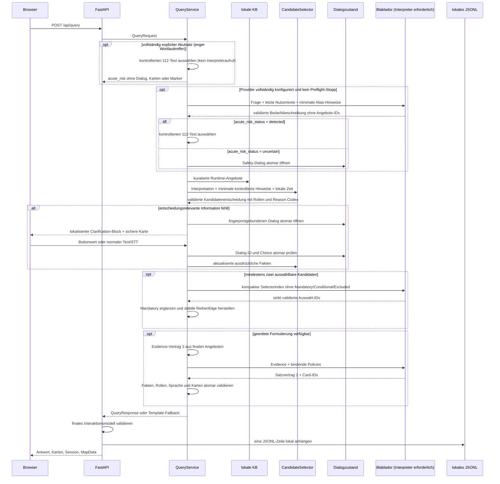

# Datenflüsse und Schnittstellen

## Nutzeranfrage

Das Diagramm fasst alternative Pfade zusammen: Preflight-Safety, erkannte oder
ungeklärte Akutgefahr sowie Interpreterfehler beenden den normalen Auswahlpfad.
Die darunter dargestellten Kandidaten-/Modellschritte laufen dann nicht weiter.

`QueryRequest` enthält `query`, `language`, `input_mode` sowie optional
`category`, `session_id`, `dialog_id` und höchstens zwei `choice_values`.
Choice-Antworten dürfen nicht gleichzeitig Freitext oder Kategorie enthalten.
`QueryResponse` enthält Antwort, Karten, Providerstatus, den expliziten
`answer_type`,
Sitzungsverlauf und optionale Kartendaten. Pydantic begrenzt die Frage auf 10000 Zeichen; das konfigurierbare
API-Limit und das HTML-Eingabefeld verwenden standardmäßig 1000 Zeichen.
Whitespace wird normalisiert.

Der Interpretervertrag Version 4 unterscheidet `need`, ausdrücklich angefragte
Einzelleistungen, `scope_status`, `input_language`, ausdrücklich genannte Fakten, begrenzte unsichere Hinweise,
potenziell fehlende Informationen, ein unverbindliches Klärungssignal und
`acute_risk_status`. Unbekannte sensible Eigenschaften bleiben `unknown` oder
`null`. `age_group` trennt ausdrücklich minderjährig (`under_18`), erwachsen
ohne engere Altersangabe, 18 bis 26 und ab 27, ohne ein exaktes Alter
abzuleiten. `youth_support` entsteht nur aus einer ausdrücklichen Suche nach
Jugendhilfe beziehungsweise einem exakten Jugendangebotsalias, niemals allein
aus einem bekannten Alter. Bei offenem Dialog enthält der Interpreterpayload nur
Dialogart, angefragte Felder, erlaubte Choice-Bedeutungen und bereits
ausdrücklich bekannte Fakten; keine Angebotsdatensätze oder IDs. Prompt- und
Vertragsversion stehen in `/api/health`; vollständige
Prompts und Nutzereingaben werden nicht in das technische Log geschrieben. Das
Modell formuliert weder Antwort noch Rückfrage und erhält keine Angebotsdaten.
Die getrennte Liste `explicit_service_requests` verhindert insbesondere, dass
eine grobe Essens- oder Grundversorgungsabsicht unbelegt auf Hygiene, Kleidung,
Wäsche oder Postservice ausgeweitet wird.

`acute_risk_status` ist ein verpflichtendes dreiwertiges Feld der ersten
strukturierten LLM-Antwort. Zusätzlich stoppt ein enger deterministischer
Preflight bei vollständig expliziten unmittelbaren Akutsätzen bereits vor dem
Interpreter. Bei einem Preflight-Treffer oder Interpreter-`detected` bricht
`QueryService` vor Formulator, Kandidatenbegrenzung, Karten und normaler Antwort
ab. Die Anwendung wählt einen festen Text für `de`, `en`, `pl`, `ro` oder `ru`;
das LLM kann weder diesen Text noch die Nummer 112 verändern. `uncertain` öffnet vor jedem Fachpfad den
strukturierten Safety-Dialog. Ja und Unsicher führen zum 112-Pfad; nur eine
kontrolliert ausdrückliche Verneinung zusammen mit `not_detected` darf den
ursprünglichen strukturierten Bedarf wieder öffnen. Eine kleine versionierte
Vorprüfung erkennt ausschließlich vollständige explizite Akutsätze und ersetzt
keine allgemeine Sprachinterpretation für alle übrigen Formulierungen. Ein
Preflight-Treffer öffnet keinen Bestätigungsdialog; `uncertain` aus dem
Interpreter tut dies weiterhin.

Interpreter, Selector und Formulator besitzen getrennte Stufengrenzen und
teilen zusätzlich ein monotones externes Wartebudget von standardmäßig 45
Sekunden. Vor jeder Stufe wird deren Timeout auf die verbleibende Budgetzeit
gekürzt; nach Ausschöpfung beginnt keine weitere Modellstufe. Läuft der
Interpreter ab oder verletzt seine Antwort den Vertrag, wird keine Kandidaten-
oder Infrastrukturentscheidung begonnen. Die Anwendung gibt einen lokalisierten
technischen Text mit bedingtem 112-Hinweis und gegebenenfalls einer lokal
belegten Hilfebus-Kontaktkarte ohne Marker aus und ruft
keinen nachgelagerten Provider auf. Auch eine providerfreie Templatekonfiguration
verwendet keine lexikalische Fachklassifikation.
Läuft der Selector ab, wird keine teilweise Modellmenge übernommen. Mandatory
und auswählbare Ergänzungen stammen dann in stabiler Reihenfolge ausschließlich
aus derselben `CandidateDecision`; der Provider wird in dieser Anfrage nicht
nochmals als Formulator aufgerufen. Läuft nur der Formulator ab, wird die
bestehende Template-Antwort als tatsächlich sichtbare und gespeicherte Antwort
verwendet. Ein Timeout erzeugt keinen zweiten Interaktionsdatensatz.

## Deterministische Kandidatenentscheidung

Der Vertrag `CandidateDecision` Version 2 enthält den effektiven Bedarf, die
verwendeten ausdrücklichen Fakten, `mandatory_candidates`,
`selectable_candidates`, `conditional_candidates`, `excluded_candidates`, fehlende Informationen,
Regel- und Reason Codes, UI-Konflikte und einen eindeutigen Ergebnisstatus.
Nur fachlich zulässige `direct_service`- und `referral_contact`-Einträge können
weitergegeben werden. `conditional_candidate` bleibt grundsätzlich intern. Die eng begrenzte Dialogpolitik darf einen
eindeutig per Organisationsbedarf oder kuratierter Ortsbindung bestimmten
Kontakt bedingt anzeigen, ohne Zugang oder Zuständigkeit zu behaupten.

## Kontrollierte LLM-Auswahl

Der Selectorvertrag besitzt Version 1, der Selectorprompt Version 3. Das Modell erhält
die aktuelle untrusted Anfrage, die strukturierte Bedarfsart, notwendige Orts-
und Zeitangaben sowie ausschließlich kompakte `SelectorCandidateView`-Objekte
aus `selectable_candidates`. Kontakte, Adressen, URLs, WFS-Rohfelder,
Kurationsbegründungen, Mandatory-, Conditional- und Excluded-Einträge fehlen.

Bei mindestens zwei auswählbaren Kandidaten kann das Modell `selected` mit
höchstens vier aktuellen IDs oder `no_selection` zurückgeben. Reines JSON,
Feldinventar, Typen, Enum, Duplikate, Höchstzahl und jede ID werden strikt
validiert. Eine einzelne fremde ID verwirft die gesamte Antwort. Danach setzt
die Anwendung Mandatory-Kandidaten vor die gewählte Menge und stellt die
kuratierte stabile Reihenfolge wieder her. Erst daraus entsteht ein
`FormulatorEvidence`-Paket mit Evidence-Version 3 und Formulatorpromptversion
15. Es enthält
pro finalem Angebot Rolle, Mandatory-Status und ausschließlich freigegebene
Fakten mit opaken Referenzen. Der Formulator sieht weder die übrige
Kandidatenmenge noch Conditional-/Excluded-Einträge, Rohfelder,
Kurationsbegründungen oder frühere Antworttexte.

Selectorprompt 3 hält mehrere konkret passende oder komplementäre Optionen in
der Auswahl, wenn die bestehende Höchstgrenze dies zulässt. Bei einem expliziten
Tag oder einer Uhrzeit bevorzugt er Kandidaten, deren strukturierter
`schedule_match_status` bereits deterministisch `matched` ist; er darf keine
Zeitpassung selbst ergänzen.

Die Modellantwort folgt Formulatorvertrag 2. Promptversion 16 fordert bei
normalen angebotsbezogenen Antworten zwei oder drei kurze natürliche Sätze. Das
wichtigste Angebot steht zuerst, ist aber nicht mehr an ein festes
`Nutze ...`-Muster gebunden. Mehrere finale, nützliche Alternativen können in
Evidence-Reihenfolge mit je einem eigenen belegten Satz genannt werden. Bei
explizitem Zeitbezug soll eine final ausgewählte Option mit passendem Zeitfakt
nicht zugunsten ausschließlich allgemeiner Information entfallen. Der eng
begrenzte Prompt-Injection-Pfad bleibt als sichere Ausnahme einsätzig und fest
formuliert. Alle Sätze enthalten Claimtyp sowie Fakten- oder Policyreferenzen;
die Antwort enthält höchstens vier Card-IDs. Das Backend baut den sichtbaren
Text erst nach vollständiger Vertrags-, Sprach-, Rollen-, Fakten- und
Kartenprüfung zusammen. Sichtbare Modell- und Fallbacktexte verweisen dabei
nicht auf „Karten“ oder andere technische Ergebniscontainer. Eine nötige
Orientierung wird sprachabhängig als „Mehr Infos stehen unten“ ausgedrückt; die
eigentliche Kartenansicht und fachliche Angaben zur Kartenzahlung sind davon
nicht betroffen.
Eine ungültige Referenz oder ein ungeerdeter operativer Fakt verwirft die
gesamte Antwort. Verbindliche Karten und die finale Reihenfolge werden
deterministisch aus dem Evidence-Paket wiederhergestellt und können durch
`card_ids` weder entfernt noch umsortiert
werden.

Bei einem Groundingfehler kann der gemeinsame Formulatorpfad innerhalb des
Restbudgets genau einmal erneut aufgerufen werden. Nur der geschlossene
Diagnosecode wird als fester Korrekturhinweis ergänzt; die Evidence bleibt
gleich, verworfener Text wird nicht erneut eingespeist. Auch die zweite Antwort
wird vollständig validiert. Timeout/HTTP-Fehler werden nicht wiederholt;
endgültige Fehler führen zum bestehenden lokalisierten Templatefallback.

## Strukturierter Dialog

`ConversationSession.dialog` ist der einzige Klärungszustand. Er wird zusammen
mit Turns atomar gespeichert, läuft spätestens mit der Session ab und wird bei
Fingerprintwechsel verworfen. Technische Buttonwerte werden gegen Dialog-ID,
Session, Status und erlaubtes Inventar geprüft. Die erste parallele Antwort
beansprucht den Dialog; Wiederholung und Doppelabsenden enden mit dem redigierten
API-Fehler `dialog_response_invalid`.

Ein Button erzeugt keinen künstlichen Nutzertext. Die Anwendung leitet seinen
gebundenen Bedarf oder das ausdrückliche Faktum deterministisch ab und zeigt im
Verlauf nur das lokalisierte Label. Freitext und Spracheingabe werden als
untrusted input mit offenem Dialog durch den Interpreter verarbeitet. Bei einem
Interpreterfehler wird der Fachdialog geschlossen und der fail-closed
Safety-Fehlerpfad ausgegeben; es werden keine Fakten übernommen. Ein erkanntes
Risiko ersetzt jeden Fachdialog. Ein ungeklärter Safety-Dialog kann durch einen
Themenwechsel oder Out-of-Scope nicht aufgehoben werden. Texte und
Labels liegen gemeinsam mit UI- und Fallbacktexten in
`app/resources/bootstrap/i18n/application_texts.json`;
`/api/health` weist den tatsächlichen Sprachprüfstatus getrennt aus.

Die Reihenfolge ist: validierte Runtime-Freigabe, aktuelle Interpretation vor
UI-Hinweis, kuratierte Aliasbegrenzung, positiver Leistungs- oder Verweisbeleg,
Alters-/Zielgruppen-/Zugangsprüfung, dokumentierte Zeitbedingung, kuratierte
Prioritätsregel und stabile ID-Sortierung. Unbekannte Eigenschaften erfüllen
keine spezifische Zugangsbedingung. Der Stadtteil wird – außer bei bereits
kuratierten Aliaszuordnungen – nur als noch nicht validierte Bedingung im
Entscheid vermerkt. Kapazität, garantierte Aufnahme und geografische Nähe werden
nicht bewertet.

Im Schlafpfad ersetzt eine Minderjährigenentscheidung die frühere
U27-Verweispriorität. Exaktes Alter 14–17 bindet die Jugend-Notschlafstelle als
direkte Leistung vor dem Jugendnotdienst als Schutz-/Vermittlungskontakt.
Exaktes Alter 12–13 lässt die ab 14 belegte Notschlafstelle nicht zu. Bei bloß
bekanntem `under_18` bleibt sie bedingt, während der Jugendnotdienst erreichbar
bleibt. Ab 18 gelten Rücke beziehungsweise Scharni; bestehende Jugendangebote
bis 26 passieren das separate Intent-Gate nur bei explizitem Jugendbezug.
Werden die beiden VKKJ-Angebote final ausgegeben, entstehen ihre Marker aus den
hashgebundenen WGS84-Koordinaten der offiziellen Betreiberseiten. Anschrift und
Punkt bleiben dadurch derselben verifizierten Quelle zugeordnet.

Die Ergebnisliste im Frontend verbindet die vollständigen validierten
`map_data.destinations` mit final ausgewählten `cards`, für die keine
verifizierte Geometrie vorliegt. Dadurch bleibt beispielsweise der Hilfebus bei
einer U18-Schlafantwort mit seinen kuratierten Telefon- und Einsatzzeitangaben
sichtbar, obwohl für seinen mobilen Einsatz kein allgemeiner Marker erzeugt
wird. Angebotsgebundene Standpunkte wie `21:hbf-west` gelten als Darstellung
des zugehörigen Angebots und verhindern eine doppelte Ergebnisinformation.
Diese Zusammenführung erzeugt weder Koordinaten noch stationäre Adressen.

Die vollständige Entscheidung wird nicht in das Forschungsprotokoll kopiert.
Persistiert wird lediglich `candidate_selection_status`; Fakten, bedingte und
ausgeschlossene IDs, Reason Codes und freie Nutzerdetails bleiben flüchtig. Der
Formulator erhält ausschließlich den Evidence-Vertrag aus finalen IDs, Rollen
und freigegebenen Fakten; Grundcodes und die vollständige Entscheidung bleiben
außerhalb des Prompts.

Vier eng begrenzte Antworten formulieren
bewusst nicht über den Formulator, sondern nutzen feste, lokalisierte
Textbausteine (`dialogue.answers.*`): der bedingte Schlafabschluss bei weiblicher
Zielperson ohne Altersangabe, der aufgelöste Bezirkskontakt
(`ORGANIZATION_DISTRICT`), der aufgelöste Organisationsdienst
(`ORGANIZATION_NEED`) sowie ein eindeutiger Organisations-Alias-Treffer ganz
ohne Dialog. Der erste Fall nennt den vorhandenen Erstkontakt Rücke und Scharni
ausdrücklich nur unter der Bedingung der Volljährigkeit. Er erfindet kein Alter
und öffnet keine weitere Pflichtfrage. In den anderen Fällen steht der Kandidat
bereits eindeutig fest (genau ein `conditional_candidate` bzw. eindeutiger Alias).
Es besteht kein freier Formulierungsspielraum mehr; nur der erste Fall ist
schlafplatzspezifisch, die übrigen drei gelten für jeden Bedarfstyp. Das ist
eine bewusste, aber nicht in Kapitel 4 als sicherheitskritisch benannte
Ausnahme vom sonst durchgängigen Formulator-Einsatz für grounded Antworten
(entschieden im Rahmen der Untersuchung zu unbemerkten technischen
Fallbacks, siehe Fundstellen in `app/service.py`).

## Öffentliche Toiletten und räumliche Ergebnisordnung

Duschen, allgemeine Hygiene und Wäschewaschen sind keine Toilettenanfragen.
Interpreterprompt 9 ordnet solche alleinigen Anfragen `general_help` mit der
konkreten Leistung zu. Widerspricht ein `toilet`-Bedarf einer gleichzeitig
ausdrücklich erkannten Waschleistung, hat diese vor der Infrastrukturroute
Vorrang. Konkrete Leistungen lösen keine erneute allgemeine Bedarfsfrage aus.
Angebote müssen weiterhin in der kuratierten Wissensbasis belegt sein.

`app.toilet_sync fetch` lädt die amtliche CSV mit getrennten Connect-/Read-
Timeouts. `app.infrastructure` prüft UTF-8/BOM, Pflichtspalten, IDs, Kosten,
Quellkoordinaten und die EPSG:25833/WGS84-Konsistenz. Rohbytes bleiben als
`snapshot.csv`; `records.json` enthält nur das positive Runtime-Schema.
`diff.json` und `manifest.json` werden vor und nach dem Schreiben gehasht. Das
Manifest bindet Quellenmetadaten, Roh- und normalisierten Inhaltshash sowie den
Status `validated`. Bei jeder Prüfung muss sich `records.json` erneut exakt aus
`snapshot.csv` reproduzieren lassen. Mehr als 50 Prozent Datensatzverlust oder
weniger als 50 Prozent valide Geometrien sind nicht releasefähig. Ein Abruf
ändert `active_release.json` nie.

Die Runtime betrachtet lokal ausschließlich die in `active_release.json`,
`last_verified_release.json` oder `previous_verified_release.json` gebundenen
Stände, in dieser Reihenfolge. Diese Pointer entstehen nur bei ausdrücklicher
Promotion oder Rollback und binden Release-ID und Manifesthash. Zusätzlich muss
die im Manifest gespeicherte Ressourcen-URL exakt der konfigurierten
Toilettenquelle entsprechen. Pending-Releases und beliebige, zwar technisch
gültige, aber nie aktivierte Releaseverzeichnisse werden nicht durchsucht. Erst
danach ist der ebenso vollständig geprüfte und quellidentische Paket-Bootstrap
zulässig; ohne sicheren Kandidaten entsteht ein kontrollierter Fehler.

Die Runtime hält `social_offer`, `public_toilet` und `drinking_fountain`
getrennt, bindet aber alle drei Releasezustände in denselben Session-Fingerprint. Toilettenbedarf umgeht den
sozialen CandidateSelector und den LLM-Selector. Belegte Schließungen sowie
nicht valide oder doppelte Geometrien werden vor Distanz, Evidence und Karte
entfernt. Danach folgen HBF-Luftlinie und stabile ID. Höchstens drei Ergebnisse
gehen in Primärtext und Karten, alle passenden validen Geometrien in
`map_marker_ids`.

## Feste Trinkwasserbrunnen

`python -m app.drinking_fountain_sync fetch` lädt genau den von der offiziellen
Wasserwerke-Seite verlinkten KML-Export und die amtlichen Leipziger
Bezirksgeometrien. Die redaktionellen Betreiberangaben zu Kostenfreiheit,
Trinkwasser, Saison April bis Oktober und fehlendem Echtzeitstatus liegen als
kleine releasegebundene, manuell geprüfte Evidenz vor. KML, Grenz-GeoJSON,
Evidenz, normalisierte Positivliste und Diff werden einzeln und gemeinsam
gehasht; die Verifikation normalisiert alle drei Eingaben erneut. Ein Fetch
schreibt nur unter `runtime/drinking_fountains/pending/`.

Die Runtime lädt ausschließlich Active-, Last-Verified- oder Previous-Verified-
Pointer, danach den quellidentischen Paket-Bootstrap. Pointer binden Release-ID
und Manifesthash. Pending-, beliebige nie aktivierte oder live geladene Stände
sind keine Fallbacks. Der aktuelle Bootstrap enthält 30 feste und fünf mobile
Quellpunkte. 21 feste Punkte liegen nach lokaler Polygonprüfung in Leipzig;
neun externe und alle mobilen Punkte bleiben in Release und Diff, gelangen aber
nicht in Runtime, LLM, Karten oder Marker.

Bei `Need.DRINKING_WATER` begrenzt der soziale `CandidateSelector` weiterhin
nur Angebote mit positiv belegter Wasserleistung. Ein zusätzlich strukturiert
belegtes Leistungszeitfenster ist dabei verbindlich: Ohne ausdrückliche
Zeitangabe wird es gegen die aktuelle Europe/Berlin-Zeit geprüft. Der Hilfebus
ist deshalb als Wasserstelle ausschließlich Sonntag 20:00–21:00 Uhr an der
Westseite des Hauptbahnhofs zulässig; ein ausdrücklich auf Sonntag bezogener
Wasserwunsch darf ihn mit genau dieser Standzeit nennen. Die anschließende gemeinsame
Wasserprojektion ergänzt saisonal zulässige feste Brunnen, erhält fachlich
verbindliche soziale Resultate und sortiert danach nach HBF-Luftlinie und
stabiler ID. Sie umgeht den LLM-Selector. Eine ausdrückliche Brunnenanfrage
liefert im Saisonfenster Brunnen; außerhalb des Fensters können nur belegte
soziale Wasserangebote folgen. Höchstens drei Resultate gehen an Evidence und
Karten, alle zulässigen Geometrien an `map_marker_ids`.

Das Evidence-Paket enthält nur sichtbare Namen/Ortsbeschreibungen, belegte
Kosten-, Trinkwasser-, Saison- und Betriebsstatus, Quelle und HBF-Luftlinie.
Koordinaten, ausgeschlossene Datensätze und die Stadtteilangabe der Anfrage
werden nicht an den Formulator übergeben. `operation_status=unknown` und die
Groundingprüfung verhindern eine Behauptung aktueller Funktion oder Öffnung.

Bei Essen setzt `app.result_time` ohne expliziten Tag den Leipziger Kalendertag
ein. Fach- und Pflichtprioritäten bleiben vor der Entfernung; belegte
Ausgabezeiten und tatsächliche Standorte gehen Büroadresse und HBF-Distanz vor.
Ein mobiler Datensatz ohne verifizierten Standpunkt erzeugt keinen Büromarker.
TiMMi ToHelp (ID 16) bleibt dabei genau ein mobiles Leistungsangebot. Die
Kurationsschicht ergänzt aus dem offiziellen Tourplan drei ungefähre
Donnerstagsstationen (ca. 16:00 Uhr Dittrichring, ca. 16:30 Uhr Lennéanlage,
ca. 17:30 Uhr Nikolaistraße) und den Erkennungshinweis auf das bunte Team mit
zwei Bollerwagen. `thursday_16_19` begrenzt Essen, Trinkwasser, Hygiene und
Kleidung weiterhin deterministisch. Weil keine verifizierten Koordinaten für
die einzelnen mobilen Stopps vorliegen, erzeugt die Route weder einen
Büromarker noch geschätzte Tourmarker oder eine Entfernungswertung; die
unveränderte WFS-Adresse bleibt ausschließlich in Quelle und Provenienz.
Das gilt auch für den Hilfebus außerhalb seiner Sonntagsstandzeit: Bei
allgemeinen oder nicht anderweitig abgedeckten Hilfebedarfen ist er ein mobiler
telefonischer Verweiskontakt. Antwort und Karte verwenden die belegten
täglichen Einsatzzeiten aus der Runtime-KB, blenden die Büroadresse als
Nutzerstandort aus und erzeugen keinen Marker. Rohadresse und Provenienz bleiben
unverändert gespeichert.

## WFS-Aktualisierung

`sync_wfs()` ruft WFS 2.0 `GetFeature` pro Check genau einmal als GeoJSON ab.
Die Pipeline validiert Typ, Properties, eindeutige `lnr`-IDs und Geometrien und
erzeugt normalisierte `OfferRecord`s sowie stabile Feature-/Dataset-Hashes. Ein
zunächst unsichtbarer Tempordner enthält Snapshot, Canonical-Daten und Diff.
Erst nach Manifest-, Hash-, Größen-, Schema- und Basisreleaseprüfung wird er als
`runtime/wfs/pending/<release-id>/` sichtbar.

`--promote <release-id>` führt keinen WFS-Abruf aus. Es validiert exakt den
geprüften Pending-Ordner, verschiebt ihn in `data/wfs/releases/` und ersetzt
zuletzt atomar `data/wfs/active_release.json`. Bis zu diesem Pointerwechsel
bleibt der alte Release als Quelle vollständig aktiv. Die Nutzeranwendung
verwendet den Pointer nur als Quellenstatus: Fachlich aktiv bleibt ausschließlich
der an den Kurationskatalog gebundene Release. `--rollback <release-id>`
validiert einen vorhandenen
früheren Release und wechselt nur denselben Pointer. Connect-/Read-Timeouts und
alle Fehler vor dem Pointerwechsel lassen den aktiven Stand unverändert.

## Kuratierte Runtime-Sicht

`load_active_knowledge_base()` validiert zuerst den expliziten oder paketierten
Standardkatalog. `curation_path=None` bedeutet dabei paketierter Katalog und
deaktiviert die Kuration nicht. Der Katalog muss alle IDs des freigegebenen, durch Release-ID
und Hash gebundenen Quellstands genau einmal referenzieren. Danach werden
Organisation, Standort, Leistungsart, Aliase, Suchphrasen, Bedarfe und belegte
Overrides auf neue `OfferRecord`-Instanzen projiziert. Rohtext, `raw_properties`
und der normalisierte WFS-Release werden dabei nicht geschrieben oder verändert.
Angebotsspezifische Anzeigenamen überschreiben nur in dieser Projektion den
allgemeinen Organisationsanzeigenamen. Deshalb wird ID 10 als „Leipziger Oase“
ausgegeben, ohne die Organisation „Diakonie Leipzig“, Angebot ID 14 oder den
WFS-Quellennamen umzubenennen.

Die Runtime-Quellreihenfolge ist strikt: exakt gebundener verifizierter lokaler
Release, exakt passender manifest- und hashverifizierter Paket-Bootstrap,
ansonsten kontrollierter Fehler ohne Nutzerangebote. Pending-Releases,
ungeprüfte aktive Releases und beliebige ältere Stände sind keine Fallbacks.
`/api/health` unterscheidet Runtime-, Quellen- und Fallbackstatus ohne lokale
Pfade offenzulegen.

Der Interpreter erhält überhaupt keine Angebotsprojektion. Seine Aliassicht ist
eine eigene Positivliste aus Aliastext, Aliasart und Mehrdeutigkeit. Die
vorbereitete Kandidatensicht und der aktive Formulator besitzen getrennte
Pydantic-Transportmodelle mit verbotenen Zusatzfeldern. `raw_fields`,
`raw_properties`, Provenienznotizen und überschriebene Quellfakten bleiben lokal.

`include_in_runtime=false` entfernt ein Angebot vor Alias-Hinweisen,
deterministischer Kandidatenbegrenzung, späteren LLM-Kandidaten, Formulator,
Angebotskarten und Kartenmarkern. Organisationsaliase können mehrere Leistungen umfassen. Ein im
Katalog belegter Bedarf oder Ortsbezug grenzt diese Menge ein; bleibt mehr als
ein Angebot übrig, antwortet die Anwendung mit einer kontrollierten Rückfrage
statt einer willkürlichen Auswahl.

Der fachliche Review-Status lautet für den aktuellen Prototyp
`reviewed_for_prototype`; er ist keine formale institutionelle Freigabe. Ein
periodisches Review-Intervall ist `null` und noch nicht formal definiert.
Quelländerungen und der erforderliche Review vor der finalen Evaluation sind
über `/api/health` sichtbar, ohne den bestätigten Prototypbestand zu sperren.

## Übersetzungen und Lokalisierung

Die Runtime trennt drei Sprachbereiche. Kartenübersetzungen liegen im
schema-validierten Store 3; `short_description`, `services`,
`opening_hours_raw` und `notes` sind übersetzbar. Anzeigenamen, Aliase, Adressen, Kontakte, URLs und eigenständige Standzeiten werden aus der aktuellen kuratierten
Runtime-Sicht eingesetzt. Operative Tokens wie Preise und Uhrzeiten bleiben
auch innerhalb übersetzbarer Texte unverändert. Jede Sprachfassung ist an Angebot, Quellfeldhash, operative Fakten,
Kuration, Prompt, Provider/Modell und Erstellungszeit gebunden. Listenstruktur
und geschützte Tokens werden lokal geprüft. Ungültige, abgelehnte oder veraltete
Fassungen werden nicht verwendet.

Vor einem Maschinenübersetzungsrequest werden die bereits kanonisch erkannten
operativen Tokens in den vier übersetzbaren Feldern lokal maskiert. Dazu
zählen insbesondere Dezimalwerte und Preise, Telefonnummern, E-Mail-Adressen,
URLs, exakte Zeiten und Daten sowie kuratierte Namen, Aliase und Adressen, wenn
sie im übersetzbaren Text vorkommen. Jedes Vorkommen erhält in stabiler
Feldreihenfolge einen eigenen requestlokalen Marker wie `__LENA_P0000__`; das
Marker-zu-Original-Mapping verlässt den Prozess nicht. Der Provider erhält nur
die maskierten Positivlistenfelder und die Zielsprache.

Nach der Schema-Prüfung muss jeder bekannte Marker genau einmal und im
ursprünglichen Feld vorkommen. Fehlende, veränderte, doppelte, unbekannte oder
verschobene Marker sowie eine geänderte Serviceanzahl verwerfen die gesamte
Providerantwort. Erst danach werden die Originaltokens exakt eingesetzt und
die vollständige bestehende Listen-, Token-, Eigennamen-, ID- und Skriptprüfung
ausgeführt. Weder Maskierung noch erfolgreiche Wiederherstellung gelten als
menschliche Sprachprüfung; neu erzeugte Fassungen bleiben `machine`.

Als begrenzte Skriptprüfung muss eine russische Kartenübersetzung kyrillischen
Text enthalten; in englischen, polnischen und rumänischen Karten gilt
unerwarteter kyrillischer Text als Vertragsfehler. Diese Prüfung erkennt nur
klare Skriptabweichungen und ist keine Aussage über sprachliche Natürlichkeit.

`TRANSLATION_RUNTIME_POLICY` steuert die Nutzung: `reviewed_only` erlaubt nur
dokumentiert menschlich geprüfte Texte, `reviewed_or_machine` zusätzlich lokal
valide Maschinenfassungen und `source_language_fallback` ausschließlich die
deutsche Basis. Der Prototyp verwendet den zweiten Modus, behauptet damit aber
keine Sprachfreigabe. Status und Integritätsfehler werden pro Sprache in
`/api/health` ausgewiesen.

UI-, Dialog- und Fallbacktexte stammen aus einer gemeinsamen paketierten
Ressource. 112 wird als zentraler Policywert und Hilfebus-Kontakt/Zeiten werden
aus der kuratierten Wissensbasis eingesetzt; diese Fakten werden nicht in den
Sprachressourcen dupliziert. Dynamische LLM-Antworten bleiben durch Evidence-,
Grounding- und Sprachverträge begrenzt, können aber nur anhand des synthetischen
Szenariokatalogs manuell sprachlich bewertet werden. Automatische Vertrags- und
Skriptprüfungen ersetzen keine menschliche Sprachprüfung.

## Speech

`POST /api/speech/transcribe?language=de` erwartet rohe Audiobytes. Der
HTTP-Adapter erlaubt WebM, Ogg, MP4, MPEG/MP3 und WAV, prüft das konfigurierte
Byte-Limit vor und während des Streamings und ruft erst danach
`SpeechTranscriber` auf. Zu große Bodies ergeben 413, explizit nicht erlaubte
Medientypen 415 und leere Bodies 422. `SpeechTranscriber` dekodiert die
Browsercontainer im Speicher und normalisiert sie zu mono PCM16 mit 16 kHz in
einem RIFF/WAV-Container. Nur dieses WAV wird an den konfigurierten
OpenAI-kompatiblen Transkriptionsendpunkt gesendet. Die dekodierte Aufnahme ist
zusätzlich auf 120 Sekunden begrenzt; nicht dekodierbares Audio ergibt 422 und
eine Überschreitung der dekodierten Dauer 413, jeweils vor dem Provideraufruf.

`POST /api/speech/synthesize` erwartet den Pydantic-Vertrag mit `text`, einer
unterstützten `language` und `session_id`. Der Text muss exakt der letzten Antwort oder einem vom Server gespeicherten
sprechbaren Angebots-, Marker- oder Rückfragetext desselben Turns und derselben
Session und Sprache entsprechen; fremde,
veränderte oder veraltete Texte enden mit dem redigierten HTTP-409-Fehler
`tts_text_invalid`. Leere, unbekanntsprachige oder zu lange Payloads enden mit
422 vor dem Provider. Je nach Konfiguration wird ein
OpenAI-kompatibler Endpunkt oder `edge-tts` genutzt. Bei Providerfehlern
antworten beide Endpunkte mit HTTP 503 und geben keine internen Zugangsdaten
aus. Unmittelbar vor beiden Syntheseprovidern ersetzt `normalize_tts_text()`
das Token `112` durch sprachabhängig einzeln gesprochene Ziffern; im Browser
und in `QueryResponse` bleibt `112` sichtbar.

STT und TTS begrenzen das Warten auf Verarbeitung und Provider. Ein bereits
laufender STT-Decoder-Thread kann nach dem Timeout noch auslaufen; der Timeout
beendet ihn nicht zwangsweise. Ein
STT-Timeout liefert kein Transkript und löst daher keinen Query- oder
Interaktionsdatensatz aus. TTS wird erst nach der sichtbaren Textantwort
aufgerufen; sein Timeout verändert das bereits korrekte Textprotokoll nicht.

`POST /api/query` prüft nach dem absoluten Pydantic-Limit zusätzlich
`QUERY_MAX_CHARS`. Kategorieanfragen mit leerem Query bleiben zulässig; zu
lange Texte erreichen `QueryService` nicht und ergeben 422.

## Persistenz und Datenschutz

Sessions werden als JSON gespeichert, enthalten Fragen, Antworten und optional
den begrenzten strukturierten Dialog und laufen
konfigurierbar ab. Vor dem Antwortpfad löst `QueryService` die Session auf; nach
der finalen sichtbaren Antwort fügt er genau einen Turn hinzu. Der Store sperrt
den vollständigen Lese-Ändere-Schreibe-Zyklus innerhalb eines Prozesses,
entfernt abgelaufene beziehungsweise überzählige Einträge und ersetzt die
vollständig validierte JSON-Map atomar. Ein Schreibfehler liefert trotzdem das
In-Memory-Modell zurück und blockiert weder Nutzerantwort noch das getrennte
Interaktions-JSONL. Die dateibasierte Sperre koordiniert keine mehreren
Prozesse. Jede Session speichert den Fingerabdruck der kuratierten
Runtime-Wissensbasis. Fehlt er bei einer Legacy-Session oder weicht er ab, wird
der alte Verlauf weder an Interpreter noch Formulator gegeben; die aktuelle
Anfrage wird mit einer neuen Session normal verarbeitet. Ein Sprachwechsel bei
gleichem Fingerabdruck erhält dagegen Dialog und Fakten und aktualisiert nur die
Interface-Sprache. Strukturierte Nutzerdaten
werden derzeit nicht separat migriert. `runtime/` sollte daher lokal, zugriffsgeschützt und gemäß dem
Datenschutzkonzept regelmäßig bereinigt werden.

Nach einer vollständig bearbeiteten `/api/query`-Anfrage schreibt ausschließlich
der HTTP-Adapter ein zusammenhängendes Paar nach
`runtime/logs/interactions.jsonl`. Dieser Zeitpunkt liegt nach Formulierung,
Template-Fallback, kontrollierter Safety-Ersetzung und Sessionverarbeitung. Bei
Akutgefahr wird deshalb der feste sichtbare 112-Text und keine verworfene freie
LLM-Antwort gespeichert. Ein Schreibfehler erzeugt nur
`interaction.write.failed`; Anfrage und Antwort werden dabei nicht in das
technische Log kopiert und die API-Antwort bleibt erhalten.

Das JSONL enthält keine HTTP-Header, Cookies, IP-Adressen, Zugangsdaten,
Systemprompts, Provider-Rohdaten, internen Modellbegründungen oder Audiodateien.
Die enthaltenen Freitexte sind dennoch weder anonym noch automatisch
pseudonymisiert und können personenbezogene, gesundheitliche oder krisenbezogene
Informationen enthalten. Es gibt keinen automatischen Upload.
