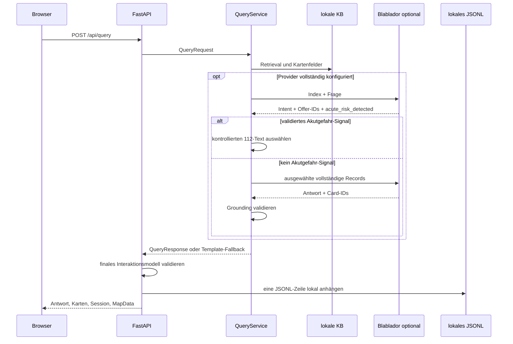

# Datenflüsse und Schnittstellen

## Nutzeranfrage

`QueryRequest` enthält `query`, `language`, `input_mode` sowie optional
`category` und `session_id`. `QueryResponse` enthält Antwort, Karten, Providerstatus,
Sitzungsverlauf und optionale Kartendaten. Pydantic begrenzt die Frage auf 1000
Zeichen und normalisiert Whitespace.

`acute_risk_detected` ist ein verpflichtendes striktes boolesches Feld der
ersten strukturierten LLM-Antwort. Bei `true` bricht `QueryService` vor
Formulator, Retrieval, Karten und normaler Antwort ab. Die Anwendung wählt einen
festen Text für `de`, `en`, `pl`, `ro` oder `ru`; das LLM kann weder diesen Text
noch die Nummer 112 verändern. Fehlende, ungültige oder nicht parsebare Felder
lösen das bestehende technische Fallback aus und gelten nicht als erkannte oder
ausgeschlossene Gefahr. Das Verfahren besitzt keine Risikostufen und keine
zusätzliche Keyword-Klassifikation.

Der LLM-Router besitzt eine kürzere Gesamtgrenze als der Formulator. Läuft der
Router ab, wird kein Safety-Wert erfunden; der deterministische Retrievalpfad
läuft weiter und das Interaktionsprotokoll markiert den kontrollierten Fallback.
Läuft nur der Formulator ab, wird die bestehende Template-Antwort als tatsächlich
sichtbare und gespeicherte Antwort verwendet. Ein Timeout erzeugt keinen zweiten
Interaktionsdatensatz.

## WFS-Aktualisierung

`sync_wfs()` ruft WFS 2.0 `GetFeature` als GeoJSON ab. Die Pipeline validiert
Typ, erforderliche Properties, eindeutige `lnr`-IDs und Point-Geometrien. Danach
entstehen normalisierte `OfferRecord`s und stabile Feature-/Dataset-Hashes.
`--check` schreibt ausstehende Daten unter `runtime/wfs/`; `--promote` ersetzt
den kanonischen Stand atomar und aktualisiert Snapshot und Änderungsbericht.
Der HTTPX-Client begrenzt Verbindungsaufbau und Lesen getrennt. Connect- oder
Read-Timeouts enden vor Normalisierung, Staging und Promotion; der vorhandene
aktive Datenstand bleibt dabei unverändert.

## Übersetzungen

Karten werden aus deutschen Quelldaten erzeugt. `offer_translation_hash()`
erkennt fachlich veränderte Angebote. Der Wartungsbefehl schreibt maschinelle
Übersetzungen nach `data/i18n/offer_translations.json`; manuelle Overrides werden
zuletzt angewendet. Nutzeranfragen lösen keine Übersetzung kompletter Angebote
aus.

## Speech

`POST /api/speech/transcribe?language=de` erwartet rohe Audiobytes. Der
HTTP-Adapter erlaubt WebM, Ogg, MP4, MPEG/MP3 und WAV, prüft das konfigurierte
Byte-Limit vor und während des Streamings und ruft erst danach
`SpeechTranscriber` auf. Zu große Bodies ergeben 413, explizit nicht erlaubte
Medientypen 415 und leere Bodies 422. Gültiges Audio wird an einen
konfigurierten OpenAI-kompatiblen Transkriptionsendpunkt gesendet.

`POST /api/speech/synthesize` erwartet den Pydantic-Vertrag mit `text` und einer
unterstützten `language`. Leere, unbekanntsprachige oder zu lange Payloads
enden mit 422 vor dem Provider. Je nach Konfiguration wird ein
OpenAI-kompatibler Endpunkt oder `edge-tts` genutzt. Bei Providerfehlern
antworten beide Endpunkte mit HTTP 503 und geben keine internen Zugangsdaten
aus. Unmittelbar vor beiden Syntheseprovidern ersetzt `normalize_tts_text()`
das Token `112` durch sprachabhängig einzeln gesprochene Ziffern; im Browser
und in `QueryResponse` bleibt `112` sichtbar.

STT und TTS haben je eine Gesamtgrenze um den tatsächlichen Provideraufruf. Ein
STT-Timeout liefert kein Transkript und löst daher keinen Query- oder
Interaktionsdatensatz aus. TTS wird erst nach der sichtbaren Textantwort
aufgerufen; sein Timeout verändert das bereits korrekte Textprotokoll nicht.

`POST /api/query` prüft nach dem absoluten Pydantic-Limit zusätzlich
`QUERY_MAX_CHARS`. Kategorieanfragen mit leerem Query bleiben zulässig; zu
lange Texte erreichen `QueryService` nicht und ergeben 422.

## Persistenz und Datenschutz

Sessions werden als JSON gespeichert, enthalten Fragen und Antworten und laufen
konfigurierbar ab. Die Speicherung ist dateibasiert und nicht gegen parallele
Schreibzugriffe mehrerer Prozesse abgesichert. `runtime/` sollte daher lokal,
zugriffsgeschützt und gemäß dem Datenschutzkonzept regelmäßig bereinigt werden.

Nach einer vollständig bearbeiteten `/api/query`-Anfrage schreibt ausschließlich
der HTTP-Adapter ein zusammenhängendes Paar nach
`runtime/logs/interactions.jsonl`. Dieser Zeitpunkt liegt nach Formulierung,
Template-Fallback, kontrollierter Safety-Ersetzung und Sessionverarbeitung. Bei
Akutgefahr wird deshalb der feste sichtbare 112-Text und keine verworfene freie
LLM-Antwort gespeichert. Ein Schreibfehler erzeugt nur
`interaction.write.failed`; Anfrage und Antwort werden dabei nicht in das
technische Log kopiert und die API-Antwort bleibt erhalten.

Das JSONL enthält keine HTTP-Header, Cookies, IP-Adressen, Zugangsdaten,
Systemprompts, Provider-Rohdaten, internen Modellbegründungen oder Audiodateien.
Die enthaltenen Freitexte sind dennoch weder anonym noch automatisch
pseudonymisiert und können personenbezogene, gesundheitliche oder krisenbezogene
Informationen enthalten. Es gibt keinen automatischen Upload.
